# Airside — airport builder, browser alpha

Phase 1 vertical slice from the design doc. You draw runways, block out terminal modules on two levels, and the game fits them out procedurally. Aircraft, passengers, bags and cars then flow through what you built. Lines grow, moods sour, and every failure can be fixed with staff, space or layout.

## Run it

```
npm install
npm run build        # writes dist/index.html; open it in any browser
npm run dev          # rebuilds on every save
npm run check        # TypeScript type-check
npm run simtest      # headless: runs 3 sim days and prints the daily report
node scripts/roads.mjs     # curves, roundabouts and one-way loops
node scripts/halls.mjs     # stacked halls and self-laid forecourts
node scripts/satellites.mjs # satellite concourses and people movers
node scripts/piers.mjs      # piers at any angle and round or polygonal hubs
node scripts/aprons.mjs     # self-laid aprons and taxilanes, and reshaping by grips
node scripts/curves.mjs     # bent piers: stands, interiors and walking routes round a curve
node scripts/stress.mjs   # 14 days with mid-day cuts and an A380 build-out
node scripts/growth.mjs   # every growth facility, international flights and the AirTrain
npm test                  # all ten sims
```

CI runs the type-check, build and all ten sims on every push and pull request. Every merge to `main` deploys the game to GitHub Pages.

There is no server. The build is one self-contained HTML file (~840 KB), with three.js (pinned, 0.170.0) bundled in for the 3D view.

## Controls

| Action | Input |
| --- | --- |
| Tools | `V` select · `1` runway · `2` taxiway · `N` new terminal · `3` hall (check-in over bag claim) · `4` security · `5` concourse · `6` satellite concourse · `9` pier at any angle · `0` round or polygonal hub · `I` passport control · `R` road · `G` roundabout · `7` curb · `8` parking · `S` sidewalk · `B` bus station · `U` rideshare · `K` rental cars · `O` hotel · `M` AirTrain · `X` demolish |
| Pan / zoom | drag empty space (or Shift-drag, right-drag) · scroll wheel · pinch on touch · in 3D: drag to orbit, right-drag to pan, scroll to zoom |
| Detail | `A` airfield · `L` landside · `Enter` (or double-click a terminal) open a terminal · `Esc` step back out · zooming moves between them too |
| Levels | `[` Ground · `]` Level 1 |
| View | `T` 3D view · `H` queue and road-congestion heatmap · `C` commercial heatmap (footfall and revenue per lot) |
| Time | `Space` pause · speed buttons 1× / 4× / 16× / 60× (game minutes per second) |
| Edit | `Ctrl`+`Z` undo · `Ctrl`+`Shift`+`Z` redo · with the Pier tool set to "A path", click each corner and press `Enter` · drag a selected module to move it, or one of its grips to stretch, swing, resize, (the filled middle grip on a pier or a hall) bend or (the diamond grips on a pier end) taper it (everything follows as you drag; `Esc` puts it back) · drag a selected road's middle handle to bend it, or an end handle to move it · `Del` demolish · inspector `−`/`+` nudges unit counts · click a lot inside a concourse to see its scores |

## What's in the alpha (v0.65)

- **Loops for turned halls, and a turning head (v0.65):** a loop flyover no longer needs its approach road square to the frontage: a hall turned on its grip, or one whose roads come in at an angle (up to about 45° off square), gets a loop at each end whose turn is as wide as the angle between road and frontage. And a trumpet's deck, which has no way down at its far side, now stays level there and widens into a turning head instead of sloping down to a dead end. 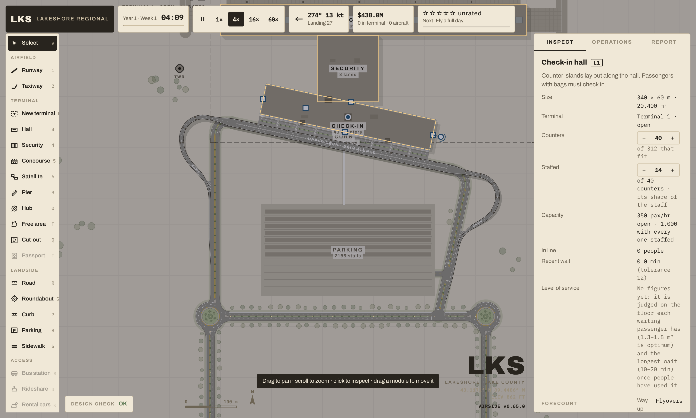

- **Forecourts that suit their site (v0.64):** a hall no longer lays the same forecourt everywhere, with its upper deck shadowing the ground road round both corners. It now chooses how the departures deck is reached from what the site allows, and says which and why in the hall's inspector:
  - **Flyovers**, where both approach roads are long and the ground beyond the corners is open: each ramp leaves its road on the side away from the terminal, and the deck runs on past the corner, crosses over the approach road and loops down beside it. Traffic climbs at one end and comes down at the other, passing the doors with the kerb on its right. Where there is room only for a narrow strip beyond the road, the ramp climbs beside it and turns over the corner instead. 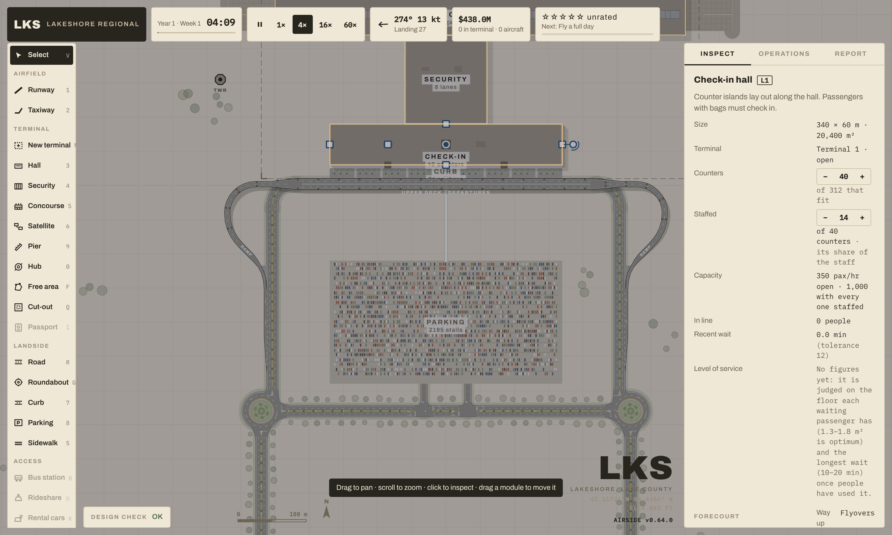 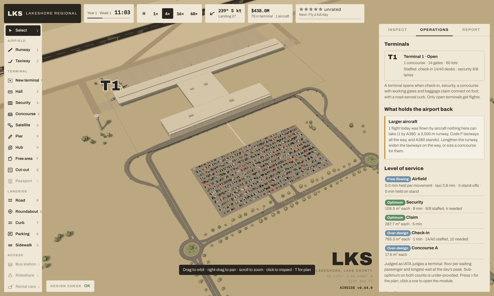
  - **A trumpet**, where only one road reaches the hall: both ramps hang on it, one up inside the corner and one down over it. 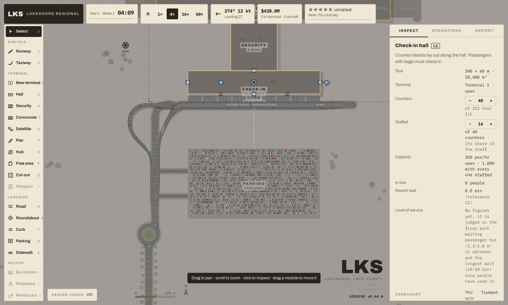
  - **Corner ramps**, as before, where the approach roads are short or the ground beyond them is built on.
  - **Straight ramps** along the deck's own road where no approach road meets the frontage square, or the frontage road is drawn by hand.

  A flyover is a bridge to the road network: cars cannot turn onto it where it crosses a road, only where it leaves its lane and where it lands. Move a car park beside a corner, cut a road or draw one, and the forecourt is laid again in whichever way now fits.
- **The roof plan in each terminal's architecture (v0.64):** seen from above, a vaulted terminal shows its glazed ridge and courses, timber and concrete ones their roof lights, eaves and fins; curb canopies in the model take the terminal's roof and column colours.

- **Runway exits that count (v0.63):** a runway's hourly rate now depends on its exits. A landing aircraft that finds an exit where it has slowed clears the runway for the next one; one that rolls on to the end holds it. Following the FAA's exit factor (AC 150/5060-5), the exits counted are those in a stretch from the landing threshold set by the aircraft that use the runway (1,065–1,980 m for A320s), each at least 230 m from the last: none there gives 24 movements an hour, one 27, two 30 (the sample, as before), three 31 and four 32. Select a runway to see the stretch marked along it, the exits counted in it, and an **Add a rapid exit** button that lays one 30° off the runway, turning the way aircraft land, to the parallel taxiway (a square one where the angled one does not fit). When flights are turned away for want of a runway slot the advisor offers the exit first, and a second runway only once no more can be laid. A stub that leads nowhere is no exit. 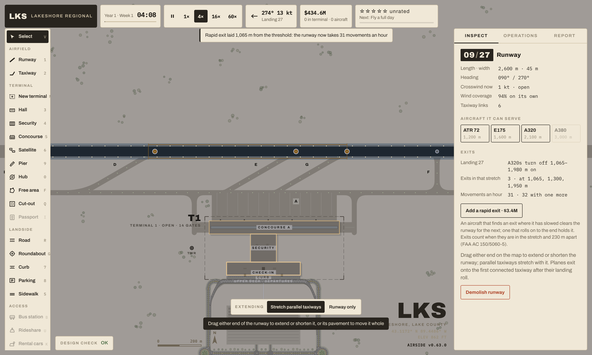

- **Modules upgraded in place (v0.62):** when a check-in hall, security checkpoint, passport control or bag claim is simply too small (every desk at work and the queue still past its limit, or people waiting on too little floor), the advisor's card now carries two buttons instead of a sentence. **Enlarge** grows the module by a quarter of its length where it stands, at whichever end or side has room: it is tried on the layout first, so it never cuts the module off from its curbs or its gates, a hall grows with the bag claim under it, every desk the new floor has room for is fitted, and the site grows to hold it. It never grows onto its own frontage road or off its curbs, and a desk module grows only where the new floor takes more desks. For check-in, security and passport control a second button upgrades the fit-out instead (kiosks and bag drop, CT scanners, e-gates), which serves more people on the floor it has; a bag claim with slow bags is told to hire handlers first. Each is priced on the button and is one undo step. 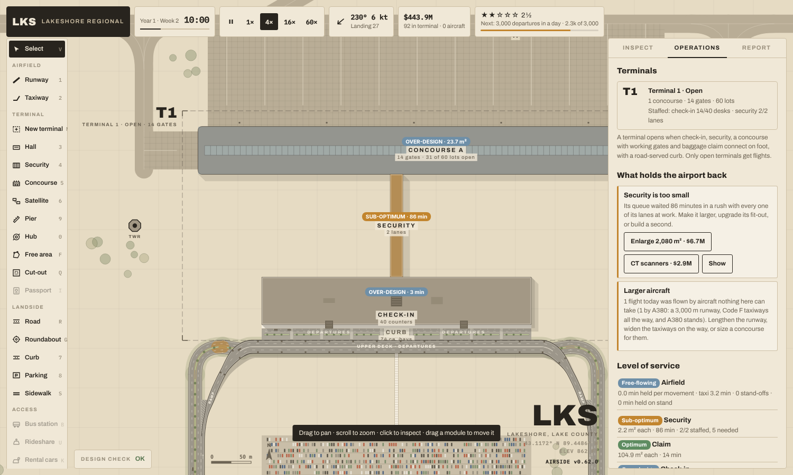
- **Architecture (v0.61):** each terminal now has an architecture, chosen in its inspector and seen in the 3D model (press T). **Model white** is the look so far: a flat white roof with a clerestory and slim mullions. **Vaulted** runs a long barrel vault with a glazed ridge over each concourse and the check-in hall. **Timber and fins** has a warm timber roof on deep eaves with a fascia, vertical fins standing off the long walls, and roof lights across the building every other bay. **Concrete bands** has board-marked concrete, a deep spandrel under ribbon glazing, a heavy roof and the same roof lights. Every building of the terminal takes it, piers, satellites, hubs and free-drawn areas included, and bent piers carry the vault, the fins and the roof lights round the curve in one rhythm. Where one building stands against another the roof stops at the wall (no eave or fins into the neighbour), and a concourse with a mezzanine keeps a flat roof under the vaulted style. It is looks only: nothing in the day's running changes. 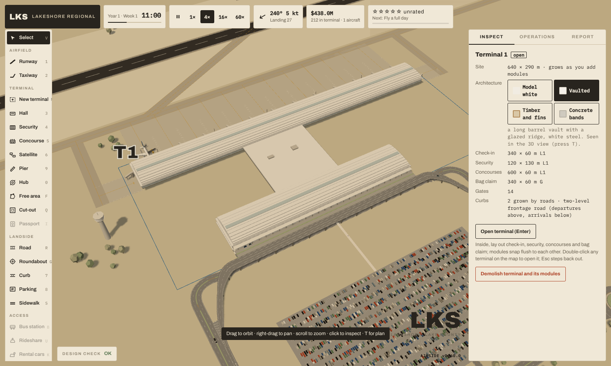 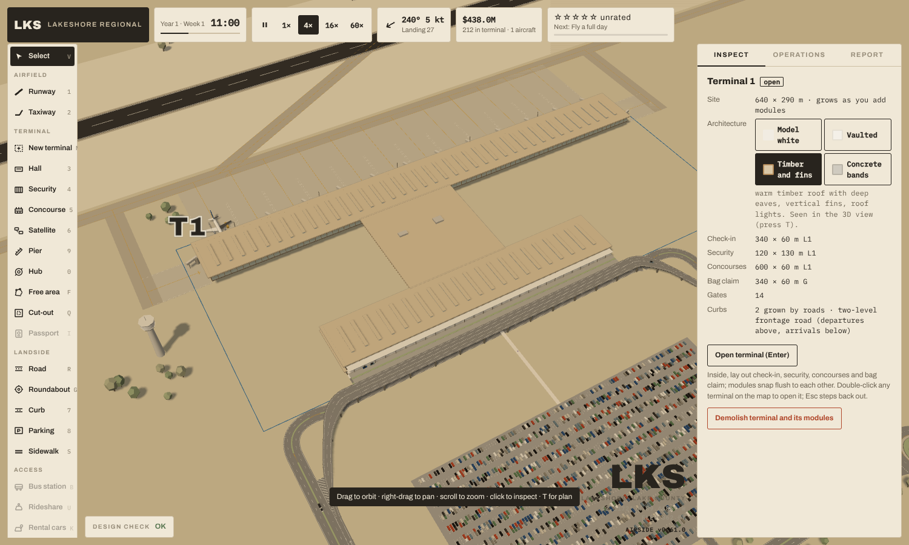 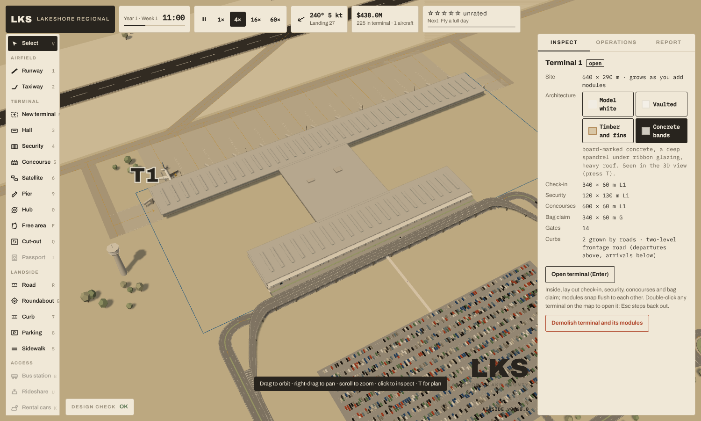
- **Banks and connections (v0.60):** an airline can now fly a *bank* here: a wave of eight of its flights that land within fifty minutes, stand together and leave together, every day for two weeks (an airline that comes asking pays $3M on signing; a bank you ask for pays nothing up front). About a third of the passengers on a bank change aircraft: they come off at one gate and walk, by way of the shops if they have time, to another, and never see check-in, security, bag claim or the kerb. A bank is the day's sharpest peak. It needs eight free stands at once (what does not fit is turned away, and the advisor says so), puts a wave of aircraft on the taxiways together, fills the concourse, and sends its local passengers through check-in and security in one rush: on the sample airport a morning bank connects about 430 passengers and, unstaffed for it, leaves some 300 local passengers behind in the queues. Ask for one in Operations (Meridian, Larkspur or Northline; morning, midday or evening), end one there, and now and then an airline offers one itself. A bank keeps to one terminal's gates, and connections are only between gates of the same terminal. Operations shows each bank's flights fitted and passengers connecting, and how many missed their connection; the advisor speaks up when more than one in twenty do.
- **The advisor (v0.59):** Operations now opens with *What holds the airport back*: the day read for you, worst first, each cause with the one upgrade that lifts it, its price, and a button that does it. Flights turned away for want of a gate: **Build N more stands** (beside the ones already built, so they share a taxilane), or, when every place is built, **Lengthen the concourse** by two stand widths at whichever end has room (its built stands stay where they are and new places open along it). Aircraft kept standing on a taxiway: **Lay a parallel** to it. A queue past its limit with desks unstaffed: **Hire** exactly the agents, screeners or officers the busiest hour needed (and where several modules share the staff, that module's dial is set so they go to it); with every desk at work and room for more: **Fit more** desks; bags slow to the belts: **Hire baggage handlers**. What cannot be done in one step (a second runway, larger aircraft, passport control, a module that is simply too small) is still said, with the figures. **Show** takes the plan to the place with the overlay on. Every upgrade is one undo step. 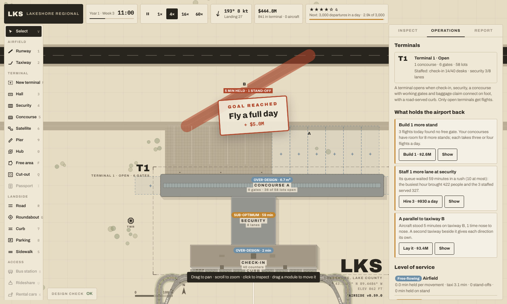
- **Ground traffic (v0.58):** aircraft now keep clear of each other on the ground, so the airfield can jam and be fixed. A taxiing aircraft keeps its distance behind the one ahead, gives way where paths cross, and queues behind a departure waiting at the runway. Two aircraft that meet nose to nose on one taxiway stand off until a tug clears them (2.5 minutes lost each time). The tower does what it can first: a departure is held on its stand a few minutes rather than pushed into traffic coming the other way, and every route avoids a stretch another aircraft is about to use in the opposite direction, so where a second taxiway exists opposing traffic takes one each without being told. An aircraft that is standing wears a ring on the plan. The day's minutes held show against each taxiway (press **H**: taxiways where aircraft stood are tinted, with the minutes and stand-offs), in the taxiway's inspector with the reason, and as an Airfield line at the top of the level-of-service table in Operations (free-flowing, flowing, congested, jammed, by minutes held per movement). **One click fixes it:** a taxiway's inspector has *Add a parallel taxiway*, which lays a second one alongside at the ICAO centre-line separation for its class (44 m, or 91 m for Code F), on the side clear of the terminal, run on to meet the runway or taxiway the first one meets (a free end gets a short link); every taxiway it crosses joins it by itself, a curve is offset along its own normals, and it is never laid twice or through stands. On a test airfield with a single link to the runway, a day loses 12 minutes with 2 stand-offs; with the parallel laid it loses none.
- **Level of service (v0.57):** every check-in hall, security checkpoint, passport control, baggage claim and concourse is now judged the way IATA's Airport Development Reference Manual judges a terminal: on the floor each waiting passenger has at the day's peak, and on the longest wait. Each count is over-design, optimum or sub-optimum; sub-optimum on both is under-provided. Press **H** and the plan tints each module by how it stands this minute and pins a chip on it with the day's band and the figure that set it. A module's inspector shows both counts against their optimum range, the busiest hour's arrivals against what its desks can serve, and what would lift it (more desks staffed, more floor, or a larger module); one with room to spare says so. The Operations tab lists the whole airport worst first, and a click on a row opens the module. Each check-in, security and passport module also has its own **staffing dial**: set how many of its desks or lanes are staffed, and the rest of the staff are shared among the others as before; Share hands it back. 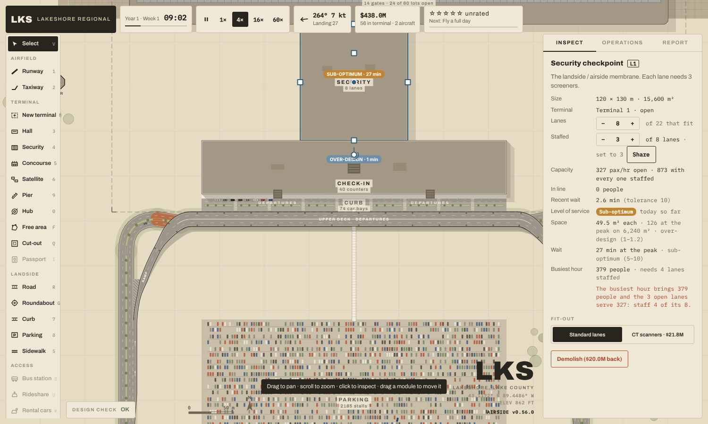
- **Stands are built, not given (v0.56):** a concourse is now a building first. Draw one and it arrives fitted out with a spine, seating, shops and window walls, and with no gates at all: each open side only offers the places an aircraft stand could go, as dashed outlines with a + on the plan. Click one to build a stand there (from $1.2M for a turboprop stand to $5.5M for an A380 one), or build a whole side from the concourse's inspector; a built stand is paved, gets its jet bridge and taxilane, and becomes a gate with a holdroom behind it, while the wall beside it stays a window wall with seating and shops. Removing a stand gives back 40% of what was paid for it (the stands an older save or the sample already had were paid for by nobody, and give nothing back); demolishing the concourse does the same for all of them. A built stand is remembered by where it is, not by a number on a wall, and it follows its wall: move, turn, swing, stretch, widen or bend the building and its stands go with it; join a pier to it and the stands the pier does not stand on are still gates. A stand is charged only where it becomes a gate: one that alone would have no way out to a taxiway or runway is not built, and the place stays on offer. A stand that later loses its place (something was built in front of it, its concourse was resized for a larger aircraft, its way out was cut) is kept for when there is room again, said once, and can be taken up from the concourse's inspector for the usual 40%. Where a side has no taxiway and no way to lay a taxilane to one, it offers nothing: draw the taxiway first. Airports from before v0.56, and the sample, keep every gate they have, now as built stands.

  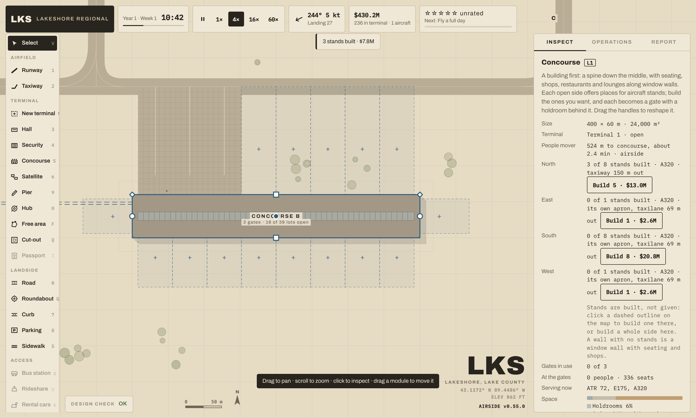

- **Shortening a runway tidies its taxiways (v0.55):** drag a runway's end back and the taxiways follow it in, as they already followed it out: a parallel taxiway that ran on to the old end is pulled back to the new one, the end link at the old threshold slides back along the runway to the new threshold, and an exit that the shorter runway no longer reaches is taken away, all live as you drag (with Stretch parallel taxiways on, as before). A taxiway that meets the stretch being given up and is not one of these (a long connector, a curved exit, a link to another runway) refuses the shortening and says so; an aircraft rolling out to an exit that has gone leaves by the nearest one still on the runway. Nothing is left pointing at bare ground past the end. `Esc` puts it all back; letting go keeps it, with 40% of the pavement back as before.

  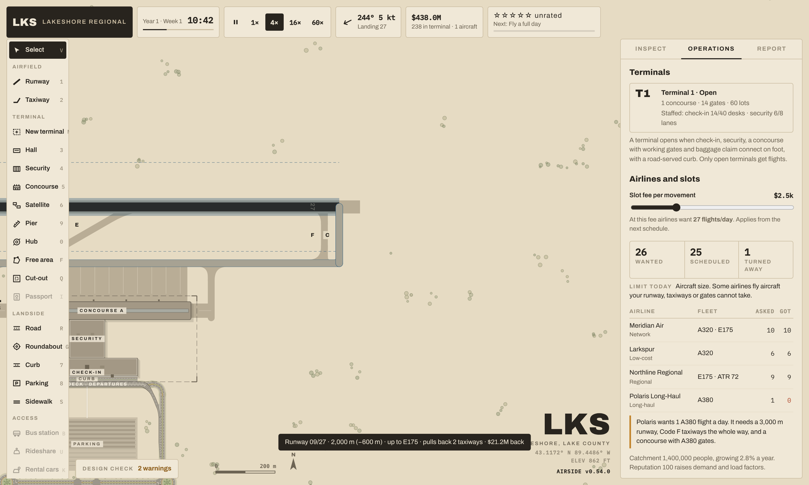

- **Moving a roundabout (v0.54):** select a roundabout and drag it by its ring, and it slides under the cursor in 5 m steps; every road that meets it stretches its end to stay on it, and the junction's entries, splitter islands and give-way lines, the forecourt links and the curbs follow live. It keeps clear of buildings, aprons, taxiways, runways, the highway and other roundabouts as when it is built, each stretched road is checked where it ends up, and any road length gained is charged when you let go (moving the roundabout itself is free). `Esc` puts it back; it can be grabbed in the 3D view too.

  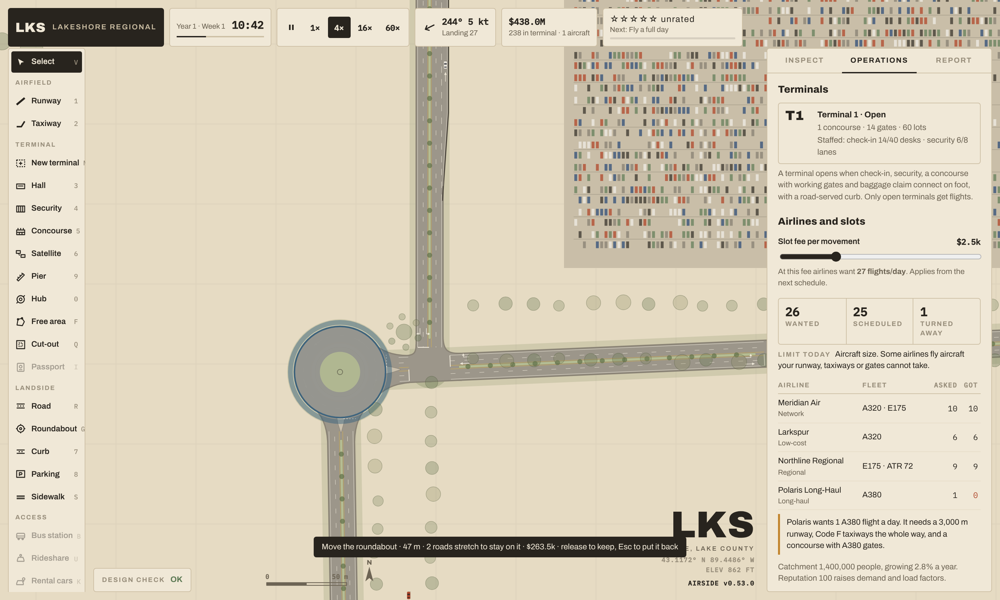

- **Moving a runway whole (v0.53):** select a runway and drag it by its pavement (the pointer shows a move cursor over it), and it slides under the cursor in 5 m steps, keeping its heading and designators, with everything following live: every taxiway that ends on it (its exits and end links) stretches to stay on it, the parallel taxiway stays where it is, and the stands, the flight plan's limits and the design check follow before you let go. The runway keeps its 150 m strip clear of buildings and roads and its spacing from other runways as when it is drawn, may not come within 90 m of a taxiway it does not carry (so it cannot be slid onto its own parallel taxiway), and each stretched taxiway is checked where it ends up; aircraft landing, rolling out or taking off on it at that moment move with it. Moving it is free; the taxiway length it adds is charged when you let go. `Esc` puts it back. Its ends (to extend it) and its pavement work in the 3D view too.

  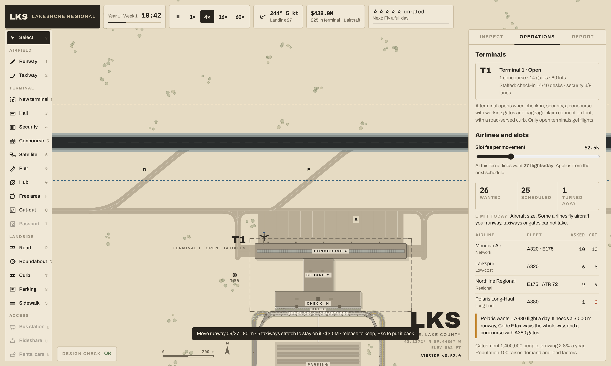

- **Moving a taxiway, road or sidewalk whole (v0.52):** select one and drag it by its surface (the pointer shows a move cursor), and it slides under the cursor in 5 m steps with everything following live: the gates and stands along it, a road's curbs and forecourt. The ways joined to its ends stretch to stay joined, and those that meet it part way along (a taxiway's exits, a side road) follow onto its new line; every one of them is checked where it ends up, and any length they gain is charged as you let go (moving the way itself is free). A way whose own end is held by something that does not move with it (a roundabout, State Route 12, a runway, or another way it meets part way along) will not slide: the hint says which end, and to drag that end instead. `Esc` puts it back. A selected way's bend and end handles, and its body, also work in the 3D view now, where the pointer grabs them instead of orbiting.

  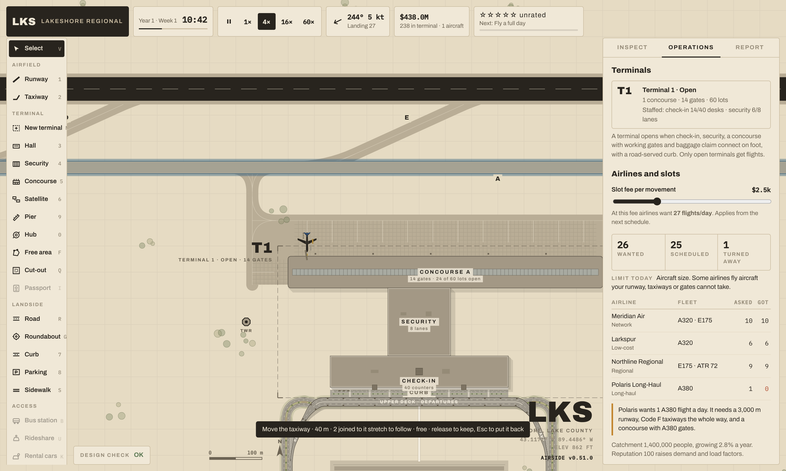

- **Drawing in 3D (v0.51):** every building tool now draws in the 3D view as it does in the plan: drag out a concourse, a satellite, a hall, security or a car park, draw a pier or a hub, or click out a path of piers, a free area or a cut-out, and what you are about to build stands in the model as you draw, with its stands, jet bridges, taxilanes, fit-out and people mover, before you let go (the model is rebuilt a few times a second meanwhile). Taxiways, roads and sidewalks drawn in 3D bring their gates and curbs with them too. A shape that cannot go there shows its true outline in red (a pier at its angle, a round hub, a free area's corners) rather than a box.

  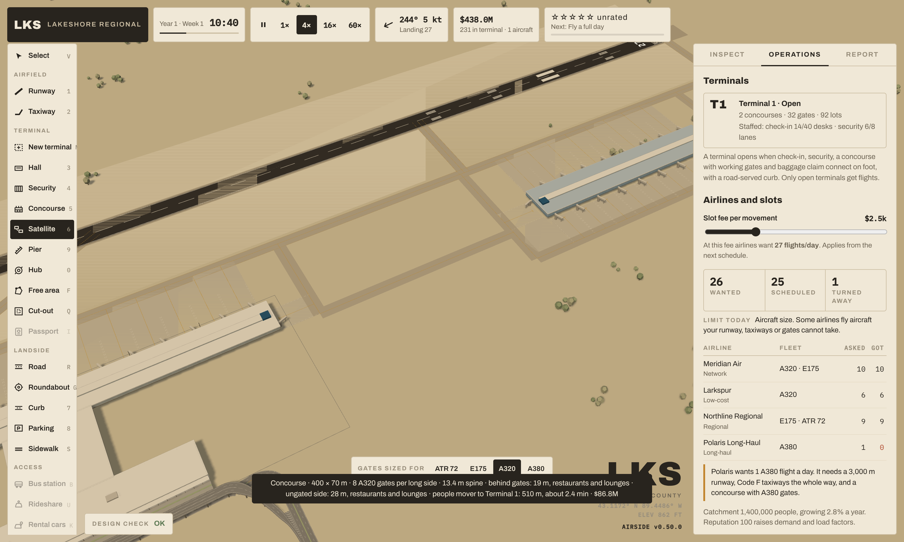

- **Runway ends that drag live (v0.50):** drag a selected runway's end to lengthen or shorten it, and the runway itself grows or shrinks under the cursor, not just an outline: its threshold markings and designators move to the new end, the parallel taxiway stretches with it and a new end link is laid as you drag, and everything that depends on the runway's length follows before you let go (which aircraft it takes, the flight plan's limit, the taxiways' letters). `Esc` puts it all back; letting go keeps it, charged as before.

  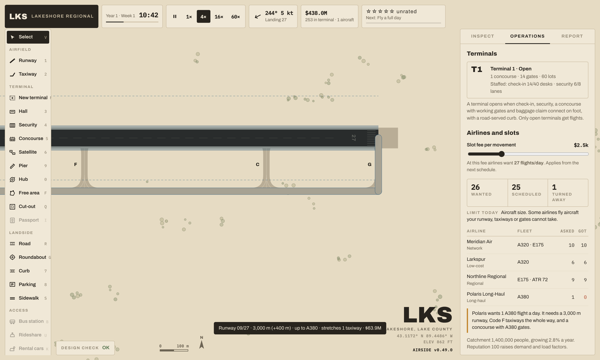

- **Moving buildings in 3D (v0.49):** select a building in the 3D view and grab its roof: the pointer turns to a move cursor over it, and dragging moves the building whole as it does in the plan, across the roof of its level, with the same rules (a hall keeps to its site, a concourse snaps against its neighbours) and the same live layout following it: stands, aprons, curbs, the forecourt and the interior. `Esc` puts it back; letting go keeps it, free of charge. Dragging anywhere else still orbits the view, and the wheel and right-drag still work over a roof.

  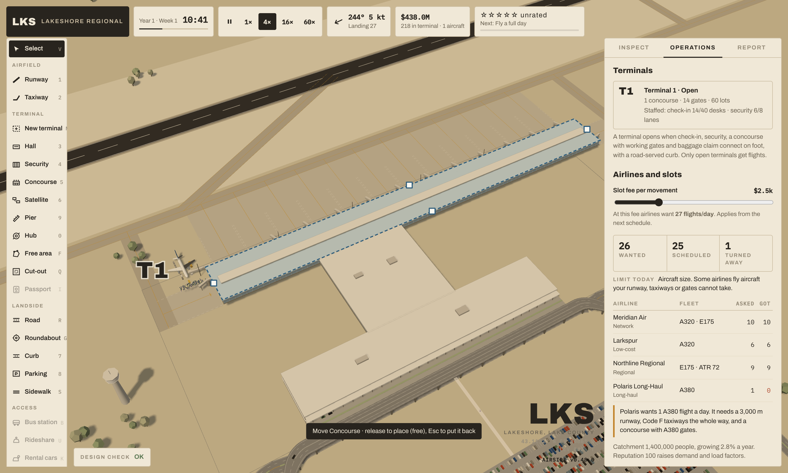

- **Gates that follow a taxiway as you drag it (v0.48):** bend a taxiway by its middle handle, drag a road's or sidewalk's end, or draw a new taxiway, road or sidewalk, and the whole layout follows the cursor before you let go, as it already did for buildings: the stands along a concourse, their aprons and taxilanes, the holdrooms and lots behind the gates, the taxiway's letter, and along a road the curbs and the forecourt. The taxiways and exits that join a bent taxiway part way along follow its curve as you drag, not only when you let go. Letting go keeps exactly what was shown (one undo step); `Esc` puts it all back. A way bent or drawn where it may not go shows red, with the layout as it was underneath.

  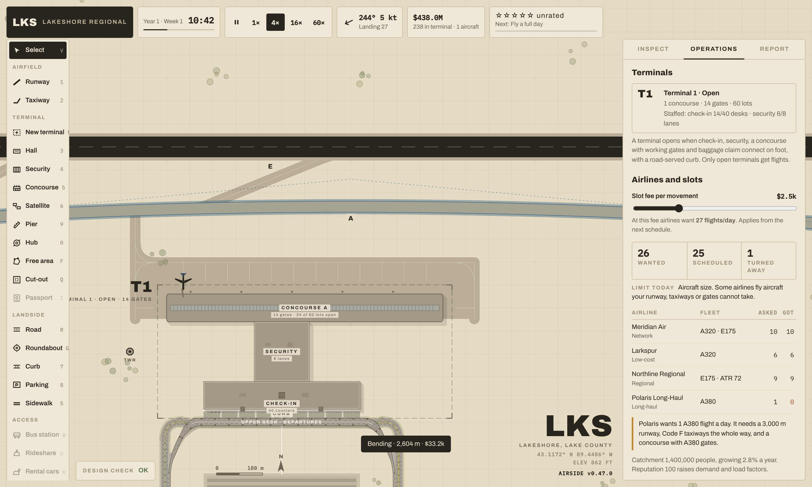

- **Cars that give way (v0.47):** cars now give way at each junction they come to, one by one, instead of every road near a junction simply counting as slower. Cars going straight along the main road through a crossroads or T, and cars already on a roundabout, keep going. Everyone else, turning in, turning off the main road or coming up a side road, stops at the line and waits for a gap. Each approach lets cars through at the rate the Highway Capacity Manual gives for the traffic it crosses: about 1,000 an hour onto an empty main road, fewer as it gets busy, and up to 1,380 an hour into a single-lane roundabout, fewer as its ring fills. The sample's roundabouts take its traffic with room to spare, so a car there seldom waits; queues build where many cars must cross a busy road, such as a one-way loop whose drives join the frontage road, and waiting cars show their brake lights.

  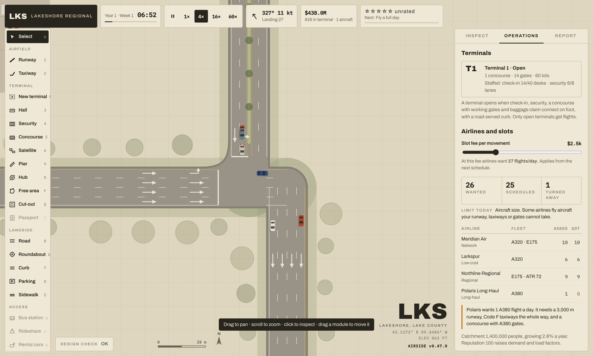

- **Curved taxiways and sidewalks (v0.46):** the Taxiway and Sidewalk tools now have the road tool's Shape option, Straight or Curve: a curve leaves in line with the taxiway or sidewalk it starts from, or sweeps round a corner on open ground. Select one already built and drag its middle handle to bend it (a taxiway keeps its ends, so its runway links stay where they are, and the exits and other taxiways that join it part way along move onto the new curve). A taxiway's centreline may not curve tighter than 45 m (60 m for Code F, of the order of the FAA's taxiway turn radii); a sidewalk turns as tight as it likes. Aircraft taxi, stands find their lanes and people walk along the curve, every clearance is tested along it, and it is drawn and highlighted as one curve in the plan and in 3D. A curved taxiway gets no automatic runway links: draw them straight.

  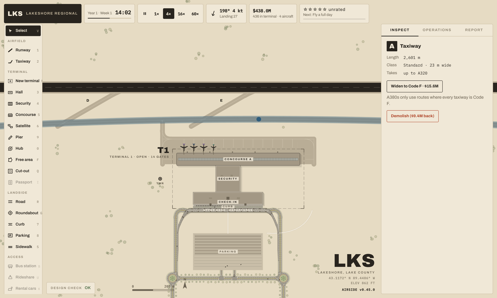

- **People-mover lines and loops (v0.45):** people movers that meet now share one station in the concourse where they meet, in its middle, so a chain of satellites is one line through several stations rather than a string of separate shuttles. A ride along it costs one wait at the platform and a half-minute stop at each station it passes through (automated people movers stop for about 20–40 seconds), and riders follow the line through those stations instead of cutting across. A line of three or more stations whose two ends are within reach of each other, and where closing it would really shorten the way round (the closing run under 80% of the line), closes into a loop, and passengers ride whichever way round is shorter. The plan names a line or a loop once, with its number of stations, and the inspector says which a mover is part of. A single mover is exactly as before.

  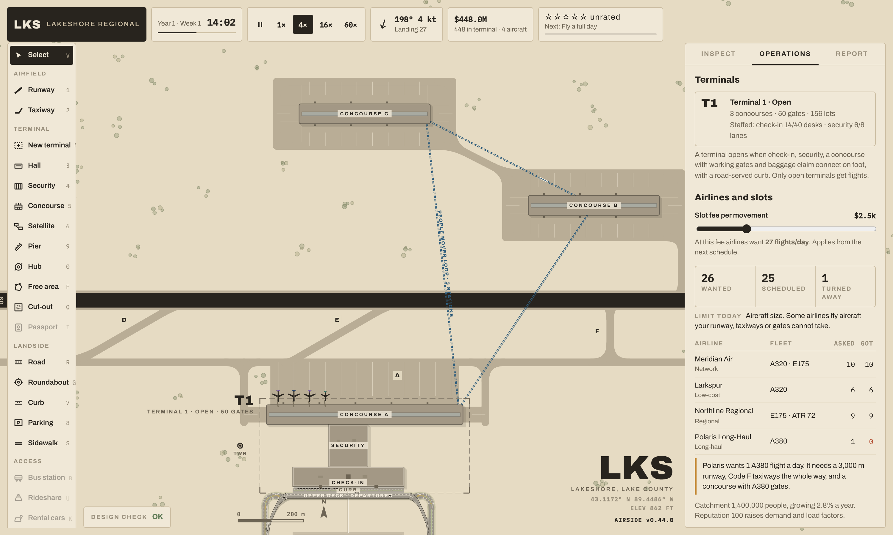

- **A landside people mover (v0.44):** a building with its own security and concourse but no check-in (a remote concourse screened at its own door) now links itself to the nearest check-in hall within 1,800 m by a people mover that runs before security, as the satellite's runs after it. Passengers check in at the hall, ride out, are screened at the far end and walk on to their gates; arriving passengers ride back to the hall and go down to baggage claim. The two buildings are one terminal, which opens across the link, even when the remote building was laid out on a New terminal site of its own. A mover only links to a hall that has no security of its own, so each terminal keeps one airside and passengers are always screened in the building their gates are in; a second terminal still being built beside a working one is never linked to the working one's hall. The line is drawn as a landside people mover in the plan, and the inspector of either end gives its length, the ride time and which side of security it runs on.

  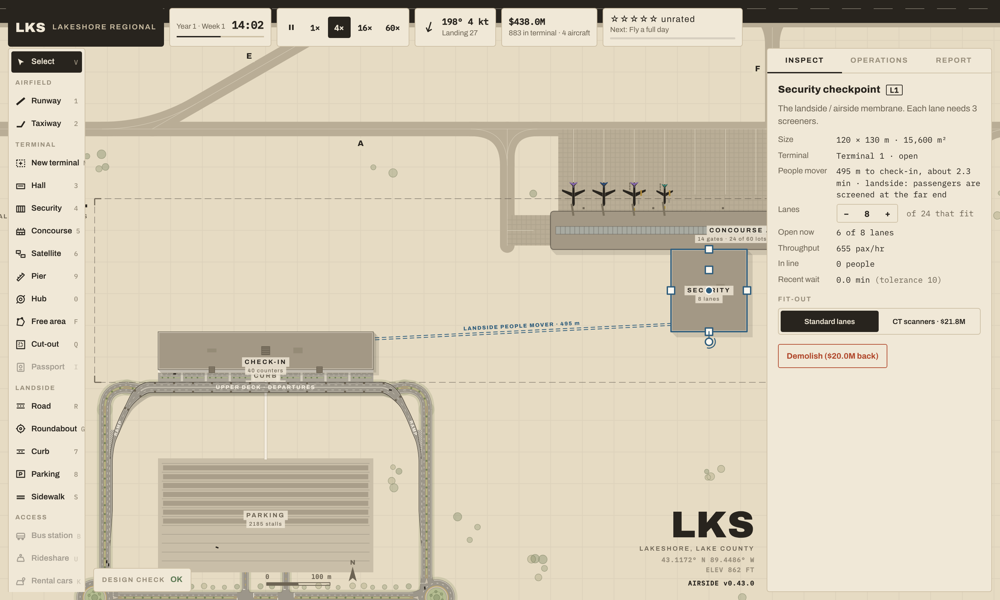

- **Grips in 3D (v0.43):** select a building in the 3D view and its grips stand on the roof of its level, round a dashed outline of its shape there: the same grips as in the plan (edges, ends, the bend and S grips, the turn handle, a free area's corners). Hover over one and the pointer grabs it instead of orbiting the view; drag it and the building is reshaped as in the plan, with the same rules, costs and hints, and `Esc` puts it back. Everything that follows a drag in the plan follows in 3D too: the outline at once, and the model itself (fit-out, forecourt, deck, stands and the rest) rebuilt a few times a second while you drag, and at once when you let go.

  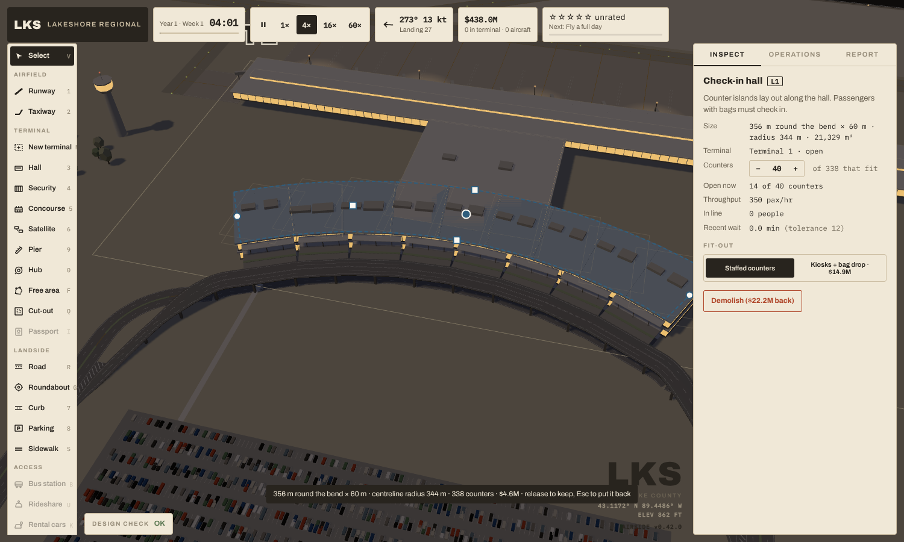

- **Tapered piers re-planned along their width (v0.42):** the inside of a pier that tapers is no longer its middle-width plan stretched across. Every holdroom keeps its true depth from its wall the whole length of the pier, and the spine keeps its true width; the lots between them take up the taper, shallow at the narrow end and deep at the wide one, and each lot is let by its true depth (so kiosks at the narrow end, restaurants and lounges at the wide one). Where an end is too narrow for lots, the holdrooms still keep their depth and the spine takes what is left; only where even the spine would be under 4 m is it all scaled across as before.

  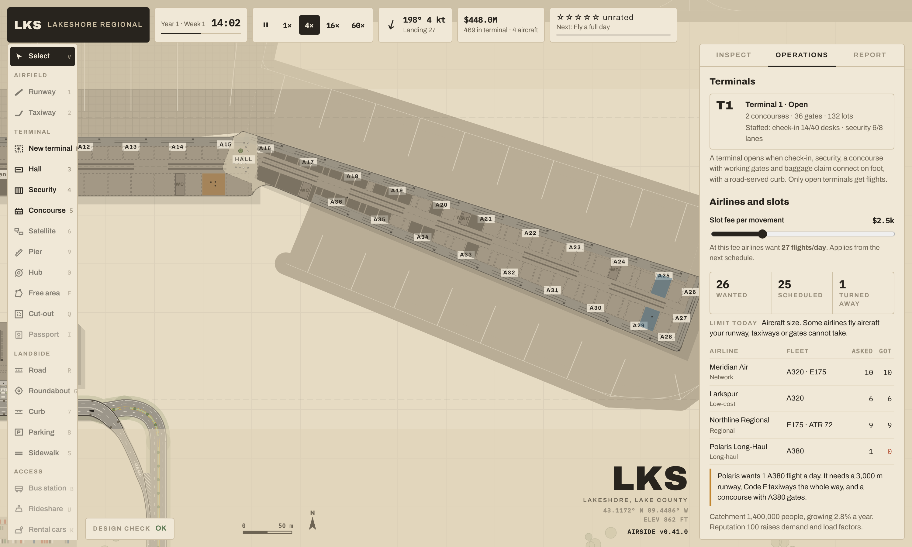

- **Halls that twist into an S (v0.41):** a hall (check-in over claim), security or passport control has a new grip on its centreline a quarter of the way along. Drag it sideways and the building twists into an S: both ends and the middle stay where they are, the centreline crosses the middle at an angle, and each half is a true arc that meets the other there without a kink. Drag the middle grip too and the S is bent as well, so one half curves more than the other. Pulled back to the line, the S goes; a hall that is straight and square to the grid again is an upright rectangle with its shared walls. Neither half may be bent tighter than a bend may be (a radius of one and a half times the width, and at least half the width plus 30 m), and the S is kept under about 40°.
  - **Everything follows it.** The fit-out is laid out on the hall's straight length and carried round both curves; the self-laid forecourt road, the curbs on both levels (a piece at a time), the departures deck and its ramps follow the S; passengers walk along it, not across it; and the 3D model is built of short lengths turned to the curve. A twist is kept through a save, and through the other grips as far as the new size allows.

  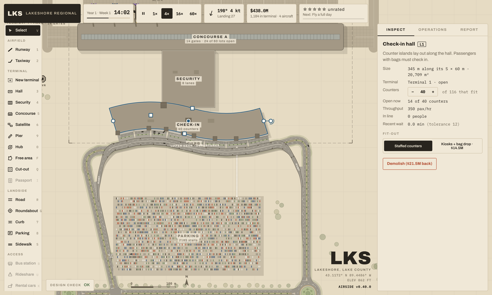
  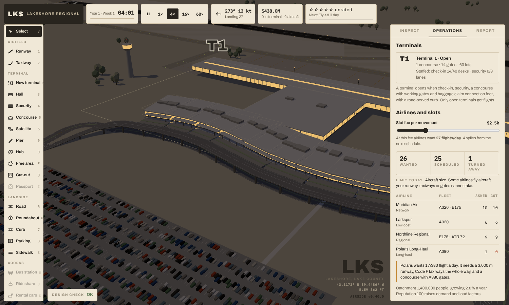

- **Walk-through duty free and holdrooms sized by seats inside a free area (v0.40):**
  - **Duty free.** Where security (or passport control) runs into a free area, the area can take walk-through duty free, switched on in its inspector as for a concourse. The store is laid first, 36 m along the wall centred on where security opens in, from where security stops to the depth of the band, with its way out on the hall side, so every departing passenger walks through it on the way to the gates. Lots give way to it; holdrooms keep their places, and no food counter stands at its way out. Where security reaches so far into the area that there is no room for a store at least 6 m deep before the middle of the floor, the inspector says so; passport control (the way in from a flight) is never the entry.
  - **Holdrooms sized by seats.** Each gate's holdroom gets the floor ACRP's holdroom rule gives for its own aircraft's seats (80% boarding, 60% of them seated at 1.4 m² and 40% standing at 0.9 m², plus the podium and the boarding queue), spread over all the wall it has behind it, plus 2 m to walk along the front. Where a corner or a neighbour cuts a gate's stretch of wall short, its holdroom is deeper rather than smaller, up to the depth of the band; with a gate spacing of wall it comes out at the usual 9 m.
  - **Nothing on top of security.** Lots, holdrooms and restroom cores are no longer laid on security or passport control where it runs into the area.

  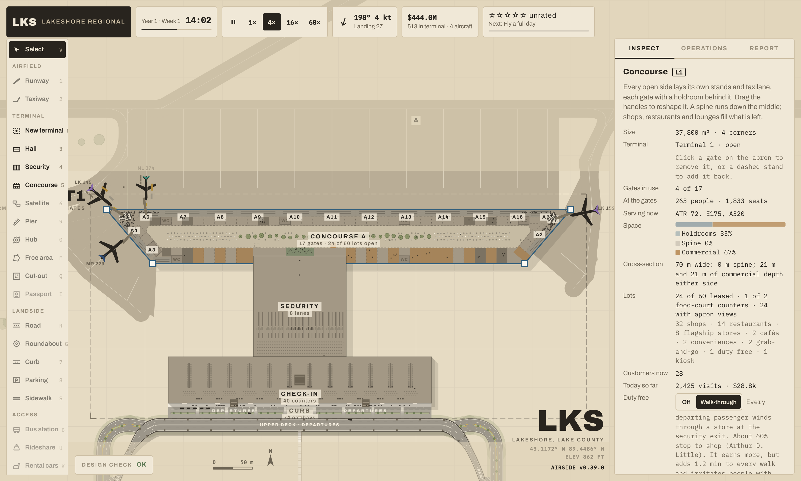

- **A curved road drawn by hand along a curved face (v0.39):** draw a road beside a bent hall and bend it by its middle handle: near the face, the handle snaps onto the dashed guide, so the curve settles at the ideal distance from the wall. The road then fronts the hall as the self-laid forecourt would. Each straight piece of the wall takes the stretch of the curve opposite it as its own frontage, so the curbs grow piece by piece on both levels; one departures deck runs the whole length of the curve and comes down along it at each end, not straight off it; and the hall lays no forecourt of its own. A gently curved road along a straight face counts too. A curve that swings away from the face (more than 3 m off straight over the face's length) grows nothing there. The guide is labelled once, on the middle of the curved wall.

  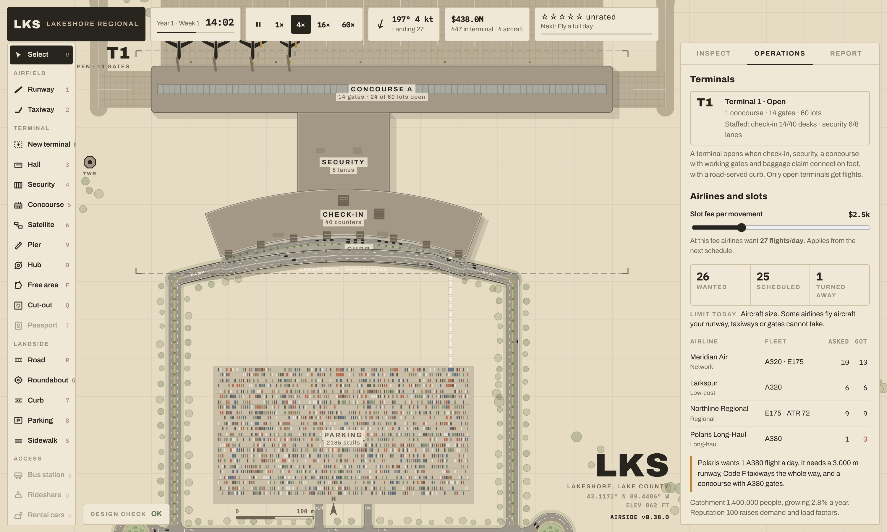
  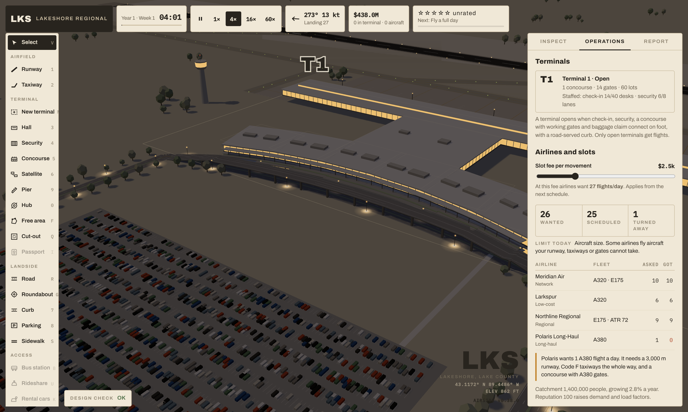

- **Restroom cores inside a free area (v0.38):** a free area now has restroom cores along its walls, about one every 160 m of wall as in a concourse (so no seat is more than about 90 m from one), each a module wide and 10 m deep where a lot would be, a window lot by preference; a gate's own way through stays open, and no food counter stands in front of one. Their places hang on the same grid as the area's lots, so changing one wall moves no restroom on another. (Holdrooms of every aircraft class come out at the 9 m minimum today, so there is nothing yet to size differently for gates of mixed sizes.)

- **Taxilane links that find their way round obstacles (v0.37):** when a run of stands has no straight way out to the airfield, and no way with one turn, its taxilane now finds a way round whatever is in the way: past the corners of the buildings, car parks and aprons nearby and round the ends of roads, keeping its aircraft class's taxilane clearance from buildings (22.5 m, 47.5 m for an A380), clear of roads and out of the runway strip, and preferring a taxiway to a runway as a straight link does. It still only reaches for a taxiway, runway or connected taxilane within 400 m of the stands, so a building far from the airfield stays cut off (and the design check still says so), and the way round may be at most 700 m long. A stand or two in a pocket of a building is still not worth a long way round and goes as before.

- **Passengers walk round courtyards and notches (v0.36):** a walk that would cross a cut-out now goes round it, by the shortest way past its corners, keeping to the floor that is left (what counts is the floor the cut-out really takes: a slot narrower than about 10 m inside the floor closes again, and a thin strip left beside a cut-out goes with it). A door or a bent pier's centre line that a cut-out reaches is stepped round. A cut-out right across a building cuts it in two: no one walks from one part to the other, and the design check says so. Nobody waits for a flight in one either: a gate whose waiting area runs into a notch keeps its passengers on the floor, and a stand laid round a notch's corner is only kept if its door is on the floor. Lots that reach into a cut-out, or whose door is in one, are not let. With a courtyard and a deep notch cut into the sample's concourse, a day's flying puts nobody in either, with nobody missing a flight.

- **Cut-outs you can reshape, and that go with their building; security and passport control that bend (v0.35):**
  - **Select a cut-out** by clicking inside it with the Select tool, where its floor is gone (a gate, security or a road inside it is still picked as itself, and a click on floor that is still there picks the building). Its outline and a square grip on each corner show, and the inspector gives its area, the building it takes floor from and whether it makes a courtyard or a notch.
  - **Drag a corner** to reshape it, or **drag inside it** to move it; the building, its courtyard, lots and stands follow as you drag, and `Esc` puts it back. Growing a cut-out costs as cutting it out did; shrinking it costs nothing. `Del`, or the inspector's button, fills it back in.
  - **A cut-out moves with its building.** Move a concourse, pier or free area and the cut-outs that take floor from it alone go with it, in the same undo step.
  - **Security and passport control bend** by the same middle grip as a hall. A bend that would pull one away from a module it is joined to is refused, so a security block between the hall and the concourse bends once it overlaps both (make it deeper first).

- **Halls that bend, with a forecourt that follows the curve (v0.34):** the check-in and claim hall now has a bend grip in its middle, as a pier does. Drag it sideways and the hall bends into an arc with both ends kept where they are; pull it back to the line between its ends and it is an ordinary upright hall again. The claim hall under it bends with it.
  - **Its fit-out follows the curve.** Check-in islands, queues, doors and the claim hall's carousels are laid out as for a straight hall and carried round the arc, so the islands fan out along it.
  - **The forecourt follows the curved face.** The self-laid frontage road runs round the curve at the usual distance, as a chain of short straight lengths. Each length grows its own curbs on both levels, and the upper departures deck runs the full length of the curve, with its ramps and corner curves at the two ends as before. Cars pull in along the curve.
  - **It joins by overlap.** A bent hall joins security, or anything else, where it overlaps it, as a turned or bent pier does. Bend its middle into security and it stays joined; a bend (or a reshape of a bent hall) that would pull it away from a module it is joined to is refused, with a hint to bend it the other way or move that module to meet it.
  - **Roads drawn by hand work too.** A road drawn along a curved face grows curbs on every piece of the wall it runs parallel to, and the hall then lays no forecourt of its own.
  - A bent hall keeps its turn handle, its end grips (to stretch and swing it) and its long-wall grips (to make it deeper), but it does not taper.

- **A free area planned from its walls in (v0.33):** a free area is no longer one open hall. Along its outside walls it is planned like a concourse, and what is left in the middle is its hall.
  - **Behind each gate, a holdroom** sized by the same ACRP load rule as a concourse's (9 m deep at least), with seating rows, and a row of lots behind it, 12 m deep, facing the hall. The lot directly behind each gate is left open as the way from the hall to the holdroom.
  - **Along a wall with no gates, deep window lots**, about 14 m wide, for restaurants and lounges.
  - **Where the area is thin,** the bands on facing walls stop short of each other to leave a 10 m aisle (ACRP Report 25 gives 9–14 m for a main circulation width).
  - **The hall in the middle** keeps its grove and seating. Food counters are no longer put in front of the lots that face it.
  - Where the free area runs into a concourse there is no wall, so nothing is planned there: that is the way through.
  - Round a courtyard cut out of a free area, window lots face the courtyard. A cut-out that splits a free area in two leaves each part planned on its own.

- **Free-drawn areas and cut-outs (v0.32):** two new tools draw a building's outline corner by corner, beside Pier and Hub.
  - **Free area (`F`).** Click each corner; click the first corner again, or press Enter, to build (Backspace undoes a corner, Esc gives up). It is open floor of any shape (at least 1,500 m²). Overlap a concourse, pier or hub and it joins that building's outline, with stands round its walls and a hall inside: a grove in the middle, seating round it and food counters round its edge (about one for every 900 m² of a large hall). Drag its corners to reshape it, or its body to move it.
  - **Cut-out (`Q`).** Click the corners of a polygon over a building and that floor is taken away: a courtyard open to the sky, planted, or a notch out of its edge. Whatever was planned there (lots, seating, the spine) stops at it. It costs 30% of the floor it takes. Click inside a cut-out with the tool to fill it back in.
  - In 3D a building with a free area or a cut-out is modelled from its outline: plinth, glass walls (round its courtyards too) and one roof.

- **Food courts and halls that trade (v0.31):** the spaces a building keeps where its pieces meet now have counters round their edge, about 7 m wide and 6 m deep, facing in to the shared tables. The way in from each spine is left open, and no counter stands on a lot of the building's own plan or beside a gate door.
  - **Food only.** The counters are let to food tenants (grab-and-go formats at this size), in step with the building's own lots: a busy building lets all of them, a quiet one fewer. The concourse panel counts them separately.
  - **Passengers use them.** On the way to their gate, a passenger who wants a meal may stop at one, like any lot; customers sit at the shared tables, so each counter serves about twelve at once.
  - **Paid like any lot.** They pay rent and earn sales like any lot, and show in the commercial heat map and the day's report.
  - Gardens and courtyards stay planted, with no counters.


- **Ramp markings in 3D (v0.30):** the 3D view now shows each ramp terminal as the plan does: the broken line between the road and the speed-change lane, the painted gore with its chevrons, and the arrows in the lane. The deck and its ramps carry their own edge lines, lane lines and the double centre line, at the height of the deck as it climbs.


- **Halls that turn, and a forecourt that follows (v0.29):** the check-in and claim hall, security and passport control can now be turned to any angle. Select one and drag the turn handle off its end: it turns about its centre in 5° steps, and turned back square it is an ordinary upright module again. Its four edge grips still move each edge, in its own turned frame. The claim hall under a check-in hall turns with it.
  - **Everything off the face follows.** The counters, queues, belts and kerb bays are laid out along the turned face. The curbs, the frontage road, the two-level deck, its ramps, gores and corner curves all run along it.
  - **Links at an angle.** When "straight out" from a turned face misses the roads, the forecourt link runs to the nearest road instead (within 45° of straight out), and it still gets a ramp with its speed-change lane and a curved corner.
  - **Joining by overlap.** A turned hall joins the security block or concourse it overlaps, as piers do. It may overlap other terminal modules on its level, but not another hall, a lot, a taxiway, an apron, or (at ground level) a road or roundabout, and it keeps to its terminal's site like any module.
  - **3D.** In 3D the turned building, its curb canopy and deck are drawn at the same angle.


- **Deck ramps that leave and rejoin the road like built ones (v0.28):** each ramp to the upper deck now meets its approach road the way a real on- or off-ramp does (a parallel-type ramp terminal), beside the road and never on top of it.
  - **Taper and speed-change lane.** The road's edge flares out over about 55 m, and a full lane then runs alongside it for about 75 m, divided from the road by a broken line. On the way up it is a deceleration lane; on the way down, an acceleration lane, with the lane tapering back into the road.
  - **Gore.** Where the ramp parts from the road there is a painted gore with chevrons. The ramp leaves at a modest angle and is about 13 m clear of the road within 60 m.
  - **It climbs only once it is clear.** The ramp stays at grade until it is 2 m clear of the road, then climbs to the deck, one lane at first and two once it is away, widening to the deck as it lands. Its shadow draws away as it rises.
  - **One way, keeping right.** The way up leaves from the right of traffic coming in; the way down joins on the right of traffic going out. Arrows in the lane show which. Cars drive the ramp as drawn.
  - Shorter approach roads get a shorter lane and taper (down to 20 m each), and the taper always merges at least 30 m before the end of the approach road, clear of any roundabout there. A car park never takes its access from a ramp, and the approach road and its planted median run on unbroken past the ramp.
  - **The ground road curves too.** Where an approach road meets the frontage road, the ground-level road sweeps round the corner on a 35 m curve instead of turning it square.


- **Deck ramps that split and rejoin like real ones (v0.27):** the first step on the landside.
  - **A ramp peels off as a lane.** Where the upper deck leaves an approach road, it starts as that road's inside lane, one lane wide, swings away and climbs. It is two lanes once clear of the road and widens to the deck only as it lands. At the far end it comes back down and merges the same way. Before, the ramp was a wide slab laid across the whole approach road.
  - **The deck is drawn as a road.** Same surface, edge lines and lane lines as the road it leaves, with a double centre line on the level part. What shows it is in the air is its shadow, which draws away as it climbs, and its columns.
  - The same shape is built in 3D, in the road's colour.
  - How cars are routed is unchanged.


- **Interiors that stop at the building's own spaces (v0.26):** the pieces of a building now plan round the halls, food courts and gardens it keeps where they meet.
  - **Fit-out gives way.** No holdroom seating, counter or restroom of either piece stands in a junction space, and the spine and moving walkways break off at its edge and start again beyond it. The space reads as one room.
  - **Lots front the space.** A shop lot within 9 m of a hall, food court or garden is seen across it, so it scores higher for visibility. On a food court, food tenants bid more for it; on a hall, food and retail; beside a garden, sit-down food, as for an apron window.
  - **Courtyards in 3D.** A courtyard is a lawn with trees in the 3D view.
  - Tables and names of these spaces show only for the open terminal.


- **Halls, gardens and courtyards where a building's pieces meet (v0.25):** the third step of the new foundation, and the first part of planning a building's inside as a whole.
  - **Junction spaces.** Where two pieces of a building run into each other, the overlap and a few metres round it are kept clear as one open space that belongs to the building, not to either piece. By size it is a winter garden (under 400 m²), a food court (400–1,500 m²) or a hall with planting in the middle and seating round it (over 1,500 m², or where three pieces meet).
  - **Planted corners.** The floor the rounded outline adds in an inside corner joins the junction space next to it, or becomes a small garden of its own.
  - **Courtyards.** A hole enclosed by the building (four concourses round a square, a triangle between three piers) is a courtyard garden, open to the sky.
  - Only a crossing counts: a concourse lengthened by drawing another over its end is just more concourse, and a round corner hall keeps its own middle.
  - No shop lot stands in any of these spaces, so the way through a junction is open.
  - Shown in the plan view at landside and terminal zoom, with trees, tables and a name. A building of one piece has none and is unchanged.


- **Stands follow the whole building (v0.24):** the second step of the new foundation. On a building made of several pieces, stands are laid along the building's one merged outline, not along each piece's own walls.
  - **Round corners and past junctions.** Stands run on round the eased ends of piers and past the filled-in corners where pieces meet, in one sweep, with one taxilane behind them. There is no wedge of dead apron where two pieces join.
  - **They fan and close up.** Each stand takes as much wall as it needs for its wings to clear its neighbours': less than a spacing round an outside curve, more round an inside one, and none where an inside corner is too tight. Each aircraft stands on the centreline of its own wedge.
  - **No two stands share ground.** A stand is refused if it would overlap any other stand of the building (two piers facing each other across a narrow gap get one row, not two), come too close to another arm of the building, or cross a road, another building or the runway strip.
  - **Mixed sizes.** Each stand is sized for the piece its gate is in, so an A380 pier on an A320 concourse has big stands along the pier and small ones along the concourse.
  - **Drawn taxiways still count.** Where a taxiway is drawn along a stretch of wall, the stands on that stretch reach out to it and use it as their taxilane, sized down to fit if it is close. Stands next to them on a self-laid taxilane are linked straight out to the same taxiway.
  - **Landside stays landside.** A straight wall that security or a hall stands against gets no stands along its whole length.
  - A stand or two left in a pocket with no way out to the airfield is dropped.
  - A building of one piece (like the starter airport's concourse) is laid out exactly as before.


- **One building, one outline (v0.23):** the first step of a new foundation. A terminal's airside is no longer drawn as a pile of separate pieces.
  - **Pieces blend.** Every concourse, pier and hub of a building is merged into one outline. Where pieces meet, the inside corner is filled in with a 16 m radius; outside corners are eased with a 5 m radius. Nothing is clipped where one piece runs into another, and no piece shows its own edge inside the building.
  - **One name.** A building of several pieces has one name and one gate letter, with its gates numbered in one run and its gate and lot totals shown once.
  - **One roof.** In 3D a building of several pieces has a single roof to the same rounded outline.
  - **Whatever your shapes add up to.** The outline is computed from the shapes you put down, so anything that makes a shape (a pier, a path, a hub, and later a free-drawn area or a cut-out courtyard) blends into the building by itself.
  - What does not follow the outline yet: stands and aprons still run along each piece's own walls, interiors are still laid out piece by piece, and halls and security are not part of it. Those are the next steps.


- **Draw a terminal as a line (v0.22):** the Pier tool has a second way of drawing.
  - **A path.** Set the tool to "A path", click where the building starts, then click each corner in turn. Click the last corner again, or press `Enter`, to build it. `Backspace` takes the last corner back and `Esc` gives up. Each leg can run at any angle (5° steps) and is 60 m long at least.
  - **One building.** Every leg is a pier and every corner a small round hall that the two legs run into, so the whole path is one building by the usual rule that shapes which overlap merge. Start it inside a concourse and it is part of that terminal. Start another path from anywhere along the first and you have a Y or an X.
  - **You see it as you draw.** The path stands in the world while you draw it, with its stands, taxilanes and gate count, like everything else since v0.19. It is paid for and built in one step, and one undo takes it all back.
  - Afterwards each leg is an ordinary pier: stretch it, swing it, bend it or taper it by its grips.
- **The "cannot place this" message can be read.** It was red text on a red bar; it is now light text on the red bar.


- **Tapered piers (v0.21):** a pier or satellite can be wider at one end than the other, so it can be a wedge, a fan or a finger that narrows to its tip.
  - **The end grips.** A selected pier or satellite has a diamond grip on a corner of each end. Drag one off the centreline and that end gets wider; drag it in and it gets narrower. The other end keeps its width and the centreline stays where it is, so the pier tapers evenly from one end to the other. An end can be from 24 to 160 m wide. Pull an end back to the other end's width and it is a plain pier again.
  - **It works with everything else.** A tapered pier can also be bent, stretched, swung and moved, and the side grips widen it as a whole, keeping its taper. Like every grip, the building follows as you drag, one drag is one undo step, and `Esc` puts it back.
  - **Stands** are square to each wall, so on a tapered pier the two rows splay apart slightly towards the wide end.
  - **Inside,** the layout is that of a pier of the middle width, squeezed towards the narrow end and stretched towards the wide one: holdrooms, spine and shop lots all get shallower or deeper with the building.
  - It is drawn as a wedge in the plan, and in 3D as a row of short lengths stepping in width.


- **Bent piers (v0.20):** a pier or satellite can be bent into a curve, so terminals no longer have to be made of straight bars.
  - **The bend grip.** A selected pier or satellite has a filled grip in its middle. Pull it sideways and the pier bends into an arc; both ends stay exactly where they are. Pull it back to the line between the ends and the pier is straight again. Like every grip, the building and everything on it follow as you drag, one drag is one undo step, and `Esc` puts it back.
  - **How far it bends.** The inner wall keeps a radius people can walk and furniture can follow: the centreline radius is at least one and a half times the width, and at least 30 m more than half the width (a 50 m pier bends no tighter than a 75 m radius). The grip stops there.
  - **Stands follow the curve.** Each stand is square to its own piece of wall. On the outside of the bend aircraft fan out, so they stand closer together along the wall and the outside gets more gates; on the inside they close up, so each needs more wall and the inside gets fewer. Spacing is set where the wings are, and on the inside also where the tails meet. Where the inside is too tight for a taxilane behind the tails (under a 30 m radius) it gets no stands, and the inspector says so.
  - **Curved aprons and taxilanes.** The apron is the band the stands sweep; the taxilane runs round behind their tails and joins the lanes at the pier's ends, round its tip, and on to the airfield, as on a straight pier.
  - **Inside.** The interior is laid out as for a straight concourse as long as the arc, then carried onto it: holdrooms behind the gates (meeting halfway between doors, since doors are not evenly spaced on a curve), the spine, shop lots either side, restroom cores. Footfall is counted round the bend. People walk along the centreline, so nobody cuts across outside the building.
  - **Everything else still works on it.** A bent pier drawn out of a concourse is part of that building; a pier or hub drawn into a bent pier joins it; one that stands apart links by people mover. It stretches and swings by its ends and widens about its centreline, keeping its bend. It is drawn curved in the plan and as a row of short straight lengths in 3D.
  - Bending costs the floor area it adds (a 500 m pier bent 120 m is 574 m round the bend).


- **Shapes you can pull about, and aprons that lay themselves (v0.19):** building is now a matter of drawing a shape and pulling it until it looks right, with everything that depends on it following as you drag.
  - **Stands lay themselves.** Every open side of a concourse, pier or hub lays its own apron: stands nose-in on the usual grid, a taxilane along their tails, and a link to the nearest taxiway, taxilane or runway within 400 m. No taxiway has to be drawn alongside. A round hub is ringed with aircraft; a pier has stands down both sides and round its tip; a runway and one concourse are already a working airfield.
    - Stand depth is the nose-in gap, the aircraft, then the taxilane's clearance to an object: 22.5 m for code C aircraft and 47.5 m for code F (ICAO Annex 14, Table 3-1, as quoted in secondary sources). That comes to 69 m for A320 stands and 129 m for A380 stands.
    - First come, first served: a stand needs its whole cell clear of other buildings, of aprons already laid, of roads and sidewalks (drawn, or laid by a hall, car park or facility for itself), and of the runway strip. The landside is laid first, so no taxilane crosses a forecourt, a lot's sidewalk or a facility's drive. A side that security or a hall stands against is landside and gets none.
    - Taxilanes on neighbouring sides meet at the corner and the corner is paved. Where a building is too narrow for a stand on its end, the lanes on its two long sides meet round that end. A loose end runs straight on, straight out, or on a little and then out or round the end of the building, whichever is shortest. Joining a runway directly counts two and a half times its length, so a taxiway wins when one is near.
    - A taxiway drawn parallel to a side still takes that side over, as before, with deeper stands if it is farther out.
    - A self-laid apron gives way: build or draw a road across it and the stands there go. Stands can still be switched off one by one.
  - **Grips.** Select a building and it shows its handles.
    - A pier or satellite has a round grip on each end: drag one and the far end stays put while the near end follows the cursor, so the pier stretches and swings in one move (5° steps). Square grips on its sides set the width, 30 to 120 m.
    - A hub has one grip on its rim: it sets the diameter, and turns a polygonal hub.
    - Every upright module (hall, security, concourse, car park, curb and the rest) has a square grip on each edge: drag it and that edge moves while the opposite one stays. The baggage claim under a hall follows its check-in.
    - Growing costs the extra floor area; shrinking gives 40% back. One drag is one undo step. `Esc` puts it back.
  - **Everything follows as you drag.** While a grip or a building is dragged, and while a new concourse, pier, hub or hall is being drawn, the shape itself is in the world: its gates, aprons, taxilanes, shop lots, people mover and forecourt are rebuilt every frame under the cursor, before you let go. The clock stands still meanwhile. If the cursor goes somewhere the shape cannot, it stays at the last place that fits and the outline turns red with the reason. Since v0.43 grips work in 3D too, where the model follows a few times a second.
  - **New terminal is an empty site.** The New terminal tool now allocates the land and nothing else, so the terminal is yours to shape. The one-drag starter layout is still there as an option on the tool.
  - **Fixed:** an angled pier now reads its neighbours in its own frame, so its entry and its windowless walls are where they really are; where one building runs into another no shop lot stands in the overlap, so a pier drawn into a concourse has an open mouth; a hub with two stands on a facet now gives both a holdroom.


- **Round and polygonal hubs (v0.18):** the halls where piers and concourses meet.
  - **Hub tool (`0`).** Drag out from the centre. Choose Round, Hexagon or Octagon, from 60 to 400 m across; a polygon turns so a facet faces the way you drag.
  - **It merges like everything else.** Overlap a concourse, a pier or security and the hub becomes part of that building. Start piers inside it and they join too, at any angle, so a hub with piers fanning out of it is one terminal. A hub that touches nothing links itself by people mover.
  - **Inside, a hub is an atrium with shops round it.** A ring of lots lines the wall, 8–16 m deep, with tenants bidding for them like any concourse lot; every shopfront faces the atrium. No lot is carved where another building runs in: that stretch of wall is the way through. A hub under about 60 m is all atrium.
  - **Gates.** Each facet has gates, with a holdroom band along that facet and the lots behind. A round hub offers twelve gate facets, a polygon one per side. Since v0.19 the stands lay themselves round the hub; a taxiway drawn parallel to a facet takes that facet over.
  - **Drawn as what it is:** in the plan a round or faceted hall with a glazed lantern over the atrium and roof ribs; in 3D a drum (or prism) with the lantern on top.
  - A hub can be moved, inspected and demolished like any module.


- **Piers at any angle, and buildings that merge (v0.17):** the foundation for terminals that are not made of upright boxes.
  - **Pier tool (`9`).** Drag a line from where the pier starts to where it ends. It can run at any angle (it snaps to 5° steps), any length from 60 m, in a width of 40, 50 or 60 m.
  - **Shapes merge.** Start the pier inside a concourse and it becomes part of that building: people walk straight through where the two overlap, with no door to line up. Two piers drawn into the same end make a fork. A pier that touches nothing is a satellite and links itself by people mover, like any other.
  - **Gates follow the angle.** Gates, stands, aprons and jet bridges grow at the pier's angle (by themselves since v0.19, or along a taxiway drawn parallel to a side). Where a pier runs into a building, only the part of each face that is actually covered loses its gates: the pier keeps gates along the rest of its length, and the concourse keeps gates either side of where the pier joins.
  - **Inside, a pier is a full concourse:** holdrooms behind its gates, a spine, shops and restaurants bidding for lots, footfall counted along its own length. It is laid out as an upright building and turned into place.
  - It can be moved (it keeps its angle), inspected and demolished like any module, in the plan and in 3D.


- **Satellite concourses on a people mover (v0.16):** the first step towards airports shaped like Tampa, Orlando, Denver or Atlanta, where the gates stand out on the airfield away from the terminal.
  - **Satellite tool (`6`).** Drag a concourse anywhere on the airfield. It needs no terminal site and does not have to touch anything.
  - **It links itself.** A concourse that touches no terminal looks for the nearest concourse that already belongs to one, within 1,800 m, and joins it with an airside people mover: a station in each and a ride between them. It then counts as part of that terminal: its gates take that terminal's flights, and its passengers use that terminal's check-in, security and baggage claim. Nothing is drawn by hand, and if you move either building the link follows.
  - **Chains and stars.** A second satellite links to whichever linked concourse is nearest, so satellites in a row chain outward (Denver, Atlanta) and satellites around a terminal each get their own line (Tampa, Orlando).
  - **In the plan** the mover is a dashed twin line with its length, and a shuttle running back and forth. It is in a tunnel, so it crosses taxiways and aprons freely; in 3D only a station pavilion shows on each roof.
  - **The ride** is eight times walking pace with a 1.5 minute average wait (planning figures from ACRP Report 37), and it does not count as walking for a passenger's mood. A mover costs upkeep by its length.
  - Gates grow on a satellite exactly as on any concourse: on every side with a parallel taxiway at the right distance. The schedule fills a terminal's nearest gates first, so a satellite fills up as the airport gets busy.
  - Out of reach, a lone concourse is still a closed terminal of its own, and the design check now says how far it can be.


- **A terminal in one drag (v0.15):**
  - **New terminal lays out the whole terminal.** Drag the terminal's rectangle and a complete starter terminal appears inside it as you drag: a concourse along the edge that faces the airfield, security behind it, and the hall (check-in over baggage claim) on the far, landside edge. The game reads which edge is airside from the nearest taxiway (or runway, if there is no taxiway yet). Release and it is built; the pieces can then be moved, resized or demolished like any others.
  - **From bare ground, five gestures make a working airport:** a runway, a taxiway, the terminal, and two roads. Gates grow where the concourse faces the taxiway and the hall lays its own forecourt to the road. In the test this flies 27 flights on its first day with no one missing a flight.
  - **A second terminal hires its own staff.** Laying out a terminal when one is already open hires 10 check-in agents and 12 screeners for it, so the first terminal's queues do not double overnight. You are told, and Operations still sets the totals.
  - The tool has a switch for an **Empty site**, for laying a terminal out by hand as before. A rectangle too small for a full layout (under 160 × 180 m) is allocated empty.
  - It costs what its modules cost: about $250M for a terminal the size of the starter one.


- **A starter airport that shows how it works, and links that find the road (v0.14):**
  - **The starter airport is rebuilt** on the hall and its self-laid forecourt. Only the approach is drawn by hand: two roads up from State Route 12, a roundabout on each, and Terminal Drive between them. The frontage road, the departures deck and its two ramps, the curbs, the car park's drives and its sidewalk are all generated. A new game (or **Load sample**) shows the whole system working; a saved game keeps the airport it has.
  - **Links turn a corner.** A forecourt link used to need a road straight ahead of it. If there is none, it now comes straight out from the frontage and turns once towards the nearest road. So a road that stops short of the terminal, or runs past off to one side, still gets connected.
  - **Reach is 360 m** (was 320 m), measured from the hall's open face.
  - **A new hall opens with a sensible number of check-in counters:** about one per 500 m², instead of every counter the floor could hold. The inspector's − and + still change it.


- **The road divides for the upper deck, and a version stamp (v0.13):**
  - **Ramps that split and rejoin.** Where a hall lays its own forecourt, the departures deck no longer sits on the road as a slab. On each side, a ramp leaves the approach road about 120 m before the corner, sweeps round inside it while it climbs, and lands on the deck in front of the hall; the ground road carries on round the corner underneath to the arrivals curb. The same happens in reverse on the way out, so the road visibly divides and comes back together. It is generated with the forecourt and moves with it.
  - **Cars take the right branch.** Cars dropping off at departures go up the ramp and leave by the other one; cars for arrivals, the car park and everything else keep to the ground road. In 3D, cars climb with the ramp.
  - A ramp is a merge, not a junction: no stop bars or turn arrows where it leaves and rejoins, and it does not slow the road the way a crossroads does.
  - A frontage road you draw by hand keeps its straight ramps along the road, as before.
  - **Version stamp.** The title block in the corner of the map now shows the version you are playing (`AIRSIDE v0.13.0`), taken from the build.


- **One hall, and a forecourt that lays itself (v0.12):** getting a road, check-in and baggage claim to line up was the hardest part of building a terminal. It no longer needs lining up.
  - **The hall.** Check-in and baggage claim are one building now: the **Hall** tool (`3`) places check-in on Level 1 with baggage claim directly under it on Ground, in one drag. The two move together and are demolished together. Separate check-in and claim modules in older saves keep working.
  - **The forecourt.** If no road runs along the hall's face, and any road (or State Route 12) is within reach of it (360 m since v0.14), the hall lays its own forecourt: a four-lane frontage road at the right distance from its open face, with a link from each end down to that road. Because departures sit over arrivals, it splits by itself into an upper departures deck and a lower arrivals road, each with its curb. So: build the hall, draw any road nearby, and the terminal has a working two-level curbside. Move the hall or the road and the forecourt follows.
  - A road you draw along the face yourself still becomes the curb, exactly as before, and then the hall lays nothing.
  - Car parks, rental centres and bus stations connect their drives to a forecourt as they do to any road.

- **Traffic that reads as traffic, and sound (v0.12):**
  - **Cars keep to their lanes.** Every car drives on the right, in a lane (two each way on a four-lane road, all lanes on a one-way road, both lanes of a large roundabout), and takes corners as curves instead of pivoting on the junction. This is how cars are drawn, in the plan and in 3D; the sim's numbers are unchanged.
  - **Cars hold a gap.** Cars on the same stretch of road queue behind the one in front, a car length and two metres apart, so a slow road shows as a line of cars with brake lights instead of cars sitting on top of each other. In the roads test, cars drawn within 3 m of each other fall by about 98%.
  - **Cars close up.** Zoomed in, cars have body colours, glass, brake lights and, after dark, headlight beams. Cars waiting for a curb bay wait in the kerb lane.
  - **Sound.** A thud when you build and a crumble when you demolish, a tick for tools, a chime for goals and unlocks, a two-note "no" when something can't be placed, a jet's roar on takeoff and landing (louder the nearer you are looking), and a quiet bed of air and terminal murmur that follows how busy the airport is. It is all synthesised in the page, so there are still no files to load. The **♪** button in the view bar turns it off; the choice is remembered.


- **Roads you can shape (v0.11):** curves, roundabouts and one-way roads, all built the same forgiving way as everything else.
  - **Curves.** The road tool has a Straight / Curve switch. A curve started from the end of a road leaves in line with it; on open ground it sweeps round a corner. Select any road afterwards and drag its middle handle to bend it, or an end handle to move that end; drag the handle back onto the line (or press Straighten) and it is straight again. The tightest curve allowed is a 14 m radius, which a bus can still make.
  - **Roundabouts.** Click to place one, Compact (36 m, one lane round) or Large (56 m, two lanes). Drop it on a crossroads, on the end of a road or anywhere along one: every road that reaches it is cut back to the ring and joins it, with a flared entry, a splitter island and a yield line. Draw a new road towards one and it aims for the centre. Traffic goes round anticlockwise and never waits for a signal, so the roads leading in hold more cars than they would at a crossroads or T, where traffic stops and starts.
  - **One-way roads.** Draw one-way in the direction you drag, or switch any road in the inspector and reverse it. Lane arrows are painted along it and the left edge line turns yellow. A forecourt can be a one-way loop: in up one side, along the terminal face, out down the other. Cars only ever drive with the arrows, and a place counts as road-served only if cars can get in from State Route 12 and back out. A loop that leads nowhere is flagged in the design check.
  - **Drawn properly.** Each road is now one smooth path between junctions, so kerbs, edge lines, lane dashes and medians follow a curve without breaks, in the plan and in 3D. Avenue trees and street lamps follow the curve too, and each roundabout gets a planted island with a paved truck apron round it.
  - **Fixed:** stop bars and turn arrows at junctions were painted on the side of the road that leaves the junction. They are now on the approach side.
  - The starter airport has a roundabout on each approach road and a curved link between them.


- **The airport grows, and growth unlocks what it needs (v0.10):** eight facilities unlock by the best day's departures, each with the reason it is needed. The Report tab lists them with progress, locked tools are greyed with their threshold, and an unlock stamps across the map. Sandbox mode (money off) has everything from the start.

  | Departures in a day | Unlocks | What it does |
  | --- | --- | --- |
  | 3,000 | Bus station | 8% of passengers come and go by bus, with no car at the curb; +5% demand |
  | 3,300 | Rideshare pickup | 20% of arriving parties meet their ride here instead of at the curb; $4 a pickup; +2% demand |
  | 3,500 | Parking decks | stack up to 6 decks on any lot to make a garage; +2% demand |
  | 3,700 | Rental car centre | 7% of arriving parties rent a car; $46 concession each; +3% demand |
  | 3,900 | Concourse mezzanine | a floor over the spine: one more lounge, double lounge capacity |
  | 4,100 | Airport hotel | eight floors of rooms; $60 to the airport per room night; +4% demand |
  | 4,300 | International flights | Aurora International asks for routes; passport control takes them |
  | 4,600 | AirTrain | stations link into a line; people ride at 8× walking pace; +6% demand |

- **Everything on the landside connects itself (v0.10, `src/frontage.ts`):** place a lot, garage, rideshare lot, rental centre, bus station, hotel or AirTrain station and it lays what it needs.
  - **An access drive** to the nearest road within 300 m, turning one corner if the road isn't straight ahead. Car parks, garages and rental centres get separate IN and OUT drives with a gate plaza.
  - **A sidewalk** to the nearest way in: the arrivals curb, a ground-floor hall, or an AirTrain station. Routes are square, not diagonal.
  - **AirTrain stations** join into the shortest line that links them all, on an elevated guideway with trains shuttling. A garage too far to walk works once it has a station.
  - A facility that can't connect is outlined in red, and the design check says why.
- **Roads worth looking at (v0.10, `src/roads.ts`):**
  - **Junctions** have curved kerbs, stop bars and turn arrows, and markings stop short of the crossing.
  - **Four-lane roads** carry a planted median with trees; every road has a grass verge and edge lines.
  - **State Route 12** is a six-lane highway with a centre barrier, and each road that meets it gets a pair of slip ramps.
  - **The curbside** is a proper cross-section: sidewalk, two pull-in lanes with bay marks, a planted island with zebra crossings, then the through lanes, painted DEPARTURES or ARRIVALS.
  - **Car parks** show every parked car in its bay; garages show a ramp helix and their deck count.
- **International flights and passport control (v0.10):** a terminal with passport control between a concourse and bag claim takes Aurora International. Arriving international passengers queue at the booths (staffed by passport officers, a new slider in Operations) before bag claim. International departures pay a higher passenger charge and spend half as much again in the shops.
- **Undo and redo (v0.10):** `Ctrl`+`Z` takes back any build, move or demolition, with its money; `Ctrl`+`Shift`+`Z` redoes it. Fifty steps.
- **Weather (v0.10):** most days are clear; some bring rain, fog or snow. Each cuts how many movements an hour the runways take (85%, 60%, 70%), shows in the header, and falls across the map in both views.
- **Airline offers (v0.10):** now and then an airline that is happy here proposes a deal in Operations: more flights for a lower slot fee, or a crew base with a signing bonus and a punctuality clause. Accept or decline.
- **The plan reads like a drawing (v0.10):** buildings, garages and hotels cast soft shadows; aprons show slab joints; the countryside has field parcels and the lake has depth rings; a scale bar and north arrow sit bottom left.
- **3D (v0.10):** garages as stacked decks with cars on the roof, a striped hotel tower, rental and bus canopies, the AirTrain on pylons with a moving train, the mezzanine storey, junction curves, medians, gate booths, and the curbside island and sidewalk.

- **A detailed 3D model (v0.9, `src/render3d.ts`, `src/models3d.ts`):** the 3D view now reads as a presentation model rather than blocks.
  - **Buildings:** each module has a dark plinth, a glazed band with mullions every 7.5 m and a white roof slab with a slight overhang. A glazed clerestory runs down each concourse's spine, and plant enclosures sit on the other roofs. Departures and arrivals curbs get canopies on slender columns.
  - **Aircraft:** modelled by class (turboprop with propellers, E175, A320, and an A380 with its double deck and four engines). Tails carry airline colours: Meridian navy, Larkspur violet, Northline teal, Polaris amber. Aircraft in motion flash a red beacon.
  - **Jet bridges:** a fixed link and rotunda stand off each gate. The tunnel docks at the forward door when an aircraft is on stand, and sits retracted otherwise.
  - **Turnarounds:** while an aircraft is being turned, a pushback tug waits at the nose, bag carts and a belt loader work the hold, a catering truck serves the forward galley, and a fuel truck stands under the wing.
  - **Painted markings:**
    - runways: threshold bars, designators, aiming points, touchdown zones, edge lines and centreline
    - taxiways: yellow centrelines and edges
    - stands: lead-in lines, stop bars and boundaries
    - roads: lane lines, with zebra crossings where sidewalks cross
    - parking: marked bays
  - **Landscape:** model trees line every road and the highway, groves dot the countryside, and the city has street trees. Planting clears itself from anything you build. A control tower stands beside the first terminal. Parked cars fill the lots as occupancy rises.
  - **Night:** glazing glows warm, runway edge and taxiway centreline lights come on, apron floodlight masts and street lamps light the ground, cars run headlights, and the sky goes to dusk blue.
  - New modules rise out of the ground into place.
- **The plan reads richer too (v0.9):**
  - a planting plan along roads and in the countryside
  - the control tower symbol (TWR) and apron floodlight masts
  - roof plans on buildings outside the open terminal: parapet line, concourse clerestory with mullions, plant enclosures
  - airline colours on tails
  - turnaround vehicles around aircraft on stand
- **Goals and an airport rating (v0.9, `src/goals.ts`):**
  - **Milestones:** eleven, each with a grant, for example: open a terminal, build a two-level frontage road, lease 40 lots, open duty free, reach satisfaction 88, welcome an A380, $250k profit in a day.
  - **Next goal:** the header shows it with a progress bar, and clicking it opens the full list in the Report tab.
  - **Celebration:** reaching a goal stamps across the map, toasts and pays the grant.
  - **Star rating:** a header rating (0.5–5) weighs satisfaction, on-time running, how much demand you could take, and missed flights. Goals are saved.
- **Feedback as you build (v0.9):**
  - New modules and curbs pulse as they appear, and what you spend floats up from where you built it.
  - A road that grows a curb says so ("+ 2 curbs"), and one that makes a two-level frontage road says that too.
- **Parking lots lay their own sidewalk (v0.9):** a lot that no sidewalk reaches lays one to the nearest ground-level curb (the arrivals curb if there is one). It goes straight or round one corner, never through a building, an apron or the airfield, and crosswalks appear where it crosses roads. The sample airport has no hand-drawn sidewalk now.

- **Three levels of detail (v0.8):** the map has three readings, and zooming moves between them.
  - **Airfield:** runways, taxiways, aprons and aircraft, with each terminal as one block on its site. Zoom out past 0.3, or press `A`.
  - **Landside:** roads, curbs, decks, parking and cars, with terminals as labelled modules. This is the middle zoom, or `L`.
  - **Terminal:** one terminal opened up, with its fit-out, lots and passengers; everything outside its site steps back. Double-click a terminal, press `Enter`, or zoom in over it. `Esc` steps back out.
  - Each tool belongs to a level. Picking it moves the map there: terminal modules open the nearest terminal, roads go to landside, runways to the airfield.
- **New terminal first (v0.8):** a terminal starts as a site. Draw it with New terminal (`N`), which is free and just allocates the land. The map then opens it and hands you check-in. Modules placed in an open terminal belong to it, and its site grows to fit them (up to 120 m beyond its edge); a module can't go on another terminal's site. Demolishing a terminal removes its site and modules together. Old saves get a site around each existing terminal.
- **Roads and terminals adapt to each other (v0.8, `src/frontage.ts`):**
  - **Curbs grow by themselves.** Run a road along a terminal's landside face, anywhere from 8 to 45 m out, and a curb fills the gap. Move the road or the building and the curb follows; take the road away and the curb goes. The road tool shows a dashed "ROAD HERE → CURB" guide 20 m out (the curb depth ACRP Report 40 suggests) and snaps to it from up to 20 m away, so roads don't need to be drawn exactly.
  - **Two-level frontage roads.** Where check-in on Level 1 sits over baggage claim on Ground along the same road, that stretch becomes an upper deck with ramps at each end. The departures curb is on the deck beside check-in and the arrivals curb is underneath beside claim. Drop-offs use the deck and pickups the lower curb, so departing passengers step straight into check-in.
  - **Modules snap flush.** Drawing or moving a module snaps its edges to nearby modules on any level (within ~12 px), so check-in can stack exactly over claim and a concourse can butt against security without pixel-hunting.
  - Hand-drawn curbs still work, for frontages a road can't reach.
- **3D view (v0.8, `src/render3d.ts`):** `T` toggles a true 3D view of the same sim, built with three.js.
  - Drag to orbit, right-drag to pan, scroll to zoom. Click to inspect; build tools draw on the ground or the current floor.
  - Terminals are massing blocks. The open terminal shows glass walls with its floor plate, counters, lanes and lots inside.
  - The upper deck stands on columns with ramps down to the road. Aircraft, cars and passengers move live, with sun shadows and night falling.
- **Starting staff (v0.8):** 18 screeners (six lanes) instead of 15. With upstairs drop-off, departing passengers reach security sooner, and five lanes left the sample's peak with missed flights.

- **Concourse commerce (v0.7, `src/commerce.ts`):** Phase 2 of the concourse interiors plan. Tenants now choose lots by what the plan and the passengers give them.
  - **Footfall:** the sim counts every departing passenger who walks past each lot's frontage, weighted by their spare time before boarding (45 spare minutes counts as one shopper; someone running for the gate counts for a tenth). Counts carry over from day to day, so a lot's footfall settles over two or three days. Until a concourse has been counted, lots use an estimate from the plan: the seats of the gates whose way from security runs past them.
  - **Visibility:** how much of the spine can see the shopfront, within a walker's forward cone and 60 m. Lots on a straight run score well; the hub face opposite the security exit scores highest; lots tucked into the spine's ends score low.
  - **Dwell:** the average spare minutes of the people walking past.
  - **Tenants bid for lots.** Core retail bids for busy, visible fronts near security; sit-down food for apron views and gate clusters; grab-and-go and convenience for the far gates; lounges for deep, quiet lots (one per ~10 gates, plus one with the premium fit-out). Every format except lounges needs traffic, so dead stretches stay vacant. The best bid wins; a sitting tenant keeps its lot unless out-bid by 15%. Rent is a minimum guarantee that follows the winning score, and each lot pays the greater of that and its sales share (the structure ACRP Report 54 describes). Lots re-let overnight as scores change, so adding or removing gates moves the tenants after the passengers, with a note in the log. The best-scoring lots lease first.
  - **Walk-through duty free:** a toggle in the inspector of any concourse that security opens straight into. The stretch in front of the security exit becomes one store that every departing passenger winds through. About 60% stop to shop (Arthur D. Little's figure for walk-through stores). It earns well, but adds 1.2 minutes to every walk and costs satisfaction for anyone with under 25 minutes to spare.
  - **Commercial heatmap (`C`):** lots shaded by footfall, labelled with their revenue, and today's flow drawn along the spine. Click a lot to see its footfall, visibility, dwell, position, each format's bid, its rent and its revenue.
  - Shoppers first decide what they want (food if they have time, otherwise a browse; a lounge for some premium passengers), then pick a lot on their way, with visible fronts drawing them in.

- **Four aircraft classes:** turboprop (ATR 72), regional jet (E175), narrow-body (A320), super-jumbo (A380). Each sets the runway length it needs (1,200 / 1,600 / 2,100 / 3,000 m), gate spacing, apron depth, seats and turnaround. Runway width follows its class.
- **Airfield you build:** runways (15° snapping, self-numbering with L/C/R parallels) and taxiways drawn segment by segment. Taxiways snap to runway ends and centrelines, apron taxilanes and each other. Standard taxiways take up to A320; Code F takes A380s. Taxiways are lettered automatically, like an airport diagram. Aircraft route over this network: landing roll to the first connected exit, taxi to the gate, back-taxi on the runway if that's the only way. Hot spots are flagged where a route crosses a runway.
- **Auto-connect (v0.3):** a taxiway drawn beside a runway (90–450 m off, within ~5° of parallel) links itself: stubs at the thresholds or at the taxiway's ends, plus exits every ~650 m. Exits past the landing roll are 30° rapid exits for the prevailing landing direction; the rest are square. Switch to Manual in the taxiway tool options.
- **Radiused junctions:** every taxiway, taxilane and runway junction gets fillets sized to the taxiway class, and painted centrelines follow the turns.
- **Extend runways:** select a runway and drag either end along its axis. You pay for the added pavement (or get 40% back when shortening). Parallel taxiways that ended at the old threshold stretch with it and get a new end stub.
- **One concourse type (v0.6, `src/bands.ts`):** gate areas and concourses are merged. A concourse's width is a budget, carved from the frontage inward:
  - a **holdroom band** behind every run of gates, sized by the ACRP load rule (80% of seats; 60% seated at 1.4 m², 40% standing at 0.9 m²; podium and boarding lane), never under 9 m;
  - a **spine** down the long axis, 9 m wide, or 13.4 m with two moving walkways on arms over 300 m;
  - **commercial lots** in whatever is left either side of the spine, sized by depth: under 4 m seating only, 4–8 m kiosks and grab-and-go, 8–15 m shops and cafés, over 15 m restaurants, flagship stores and lounges;
  - **restroom cores** about every 160 m of spine.
  Lots on an ungated exterior wall get apron views. Each lot's capacity follows its floor area. Remove gates on a side and that wall frees up for window restaurants; widen the concourse to keep both. Who leases which lot is decided by bidding (v0.7, above). A concourse with no taxiway beside it is all shops and seating, and works as a connector. Old saves convert automatically.
- **Gates on every side (v0.5):** each side of a concourse grows gates when a taxiway runs parallel to it within reach (one stand depth to max(150 m, two stand depths + 40 m)). A dashed guide shows the ideal line, and taxiways snap to it. If the taxiway is closer than the area's gate size needs, that side gets the largest gates that fit. Gates sit on a fixed grid per side, so adding or extending taxiways never shuffles them. Click a gate to remove it; click its dashed stand to add it back.
- **Interior layouts (`src/layout.ts`):** check-in islands with bag belts, queue mazes and kiosks (frontal counters in shallow halls); banked security lanes with divest, X-ray, body scanner and recompose; baggage claim with a greeters' hall, bag-service office and long carousels fed from the back wall, one carousel per three gates by default, with unbuilt positions shown dashed; concourses are carved by `src/bands.ts` (above). Each module faces the module it touches upstream. Desks, lanes and carousels open centre-out as you staff them.
- **Terminals:** modules joined by doors or cores form one terminal (sidewalks don't merge terminals). A terminal opens only when check-in, security, a concourse with working gates and baggage claim are all connected, with a road-served curb. Closed terminals get no flights and are outlined in rust with the reason. Each terminal can have several concourses; each airline has a home terminal; staff are split by each terminal's passengers.
- **Gate sizes:** choose the gate size when you build a concourse or in its inspector.
- **Roads (cars) and sidewalks (people)** are separate networks with distinct styling. Roads join State Route 12, curbs and lots, come in 2 or 4 lanes, and slow down as they fill (press `H`). Sidewalks link ground-level modules, curbs and lots; zebra crossings appear where they cross roads.
- **Real walking routes:** passengers move only through doors where modules touch, vertical cores where L1 and Ground overlap (or where L1 meets the curb), and sidewalks. A module with no route strands people: they are ringed in red, counted in the report, and miss their flights.
- **Design check:** per-module walking checks, road access for every curb and lot, taxiway links for every apron, gate-size vs runway/taxiway mismatches, all with dashed red markers on the map.
- **Demand and money:** four airlines with different fleets and price sensitivity. Network and regional carriers downgrade aircraft if yours can't take theirs; Polaris (A380) and Larkspur (A320) don't. Slot fee slider, gate and runway capacity limits, reputation, money on/off.
- **Terminal flows:** check-in, security, gates, bag claim, curb pickup and parking, with staffing sliders and queue heatmaps.
- **Time:** one live day stands in for 7 calendar days in years 1–3, then 14, then 28. The city grows each year.
- **Persistence:** autosaves to the browser after every change and every day.

## Code map

| File | Role |
| --- | --- |
| `src/config.ts` | Content data: modules, aircraft, airlines, site, tuning, palette |
| `src/geom.ts` | Geometry helpers and seeded RNG |
| `src/net.ts` | Generic line networks: split drawn segments into graphs; Dijkstra, all-pairs routing |
| `src/gates.ts` | Gate slots on each side of a concourse: along a drawn taxiway, or on an apron the side lays for itself, with its taxilane and link to the airfield |
| `src/shell.ts` | A building as one outline: every concourse piece merged and its corners rounded (clipper-lib) |
| `src/shapes.ts` | Turned rectangles, bent bars and hubs: outlines, overlaps, the straight frame a bent pier is laid out on, and the grips that reshape them |
| `src/frontage.ts` | Roads meeting terminals: curbs grown in the gap, two-level frontage roads, road guides; access drives, sidewalks and the AirTrain line that facilities lay for themselves |
| `src/ways.ts` | Roads as drawn: curves cut into chords, one-way roads, roundabouts and how roads are cut back to their rings |
| `src/traffic.ts` | Where each car is drawn: its lane, rounded corners, the gap to the car in front, brake lights |
| `src/sound.ts` | Synthesised sound (Web Audio): building, feedback, jets, ambience |
| `src/roads.ts` | Road geometry from the road graph: smooth paths, junction curves, roundabout entries, slip ramps, stop bars, arrows, medians, gate plazas |
| `src/render3d.ts` | 3D view (three.js): orbit camera, massing, decks, opened terminal, moving aircraft, cars and people |
| `src/bands.ts` | Concourse interiors: holdroom bands, spine, commercial lots and their visibility, restroom cores, the duty-free store |
| `src/commerce.ts` | Lot scores (footfall, visibility, dwell) and tenant bidding, rent, re-letting |
| `src/layout.ts` | Fit-out plans for check-in, security, claim and curbs |
| `src/world.ts` | World model plus everything derived from it: designators, classes, gates, aprons, the airfield / road / pedestrian networks, cores, fit-out frames, placement rules, design check |
| `src/sim.ts` | Simulation core (no DOM). Demand → schedule → aircraft taxi routing, passenger walking routes, cars with congestion, bags, processors, economy |
| `src/render.ts` | Canvas renderer: plan view and oblique 2.5D, cutaway levels, night lighting |
| `src/ui.ts` | Tools, input, inspector, operations and report panels |
| `src/main.ts` | Boot, save/load, frame loop |
| `src/sample.ts` | The starter airport |

The sim never reads the renderer, and the renderer never writes the sim. That split is what makes a later port of `sim.ts` + `world.ts` to Godot/C# a translation rather than a rewrite.

## Known gaps (next up, per the roadmap)

- A taxilane's way round obstacles (v0.37) turns at the corners of their bounding boxes, so round a bent pier or a free area it can be longer than it needs to be; it cannot go round the lake or a roundabout, or reach a taxiway more than 400 m from the stands.
- Construction is instant; no build time or disruption yet.
- Architecture (v0.61): four styles, per terminal, in the 3D model only (the plan does not show them); a vault is built of stepped courses, not a true curve; hubs and free-drawn buildings take a style's materials and eaves but keep their flat roofs; curbs, car parks and landside buildings have no styles.
- v0.60 also fixed an old fault at bag claim: a passenger whose bag was one more than the flight's estimate waited at the belt for good and kept the belt from being reused, so by mid-morning the sample's carousels jammed. Every bag checked is now carried.
- Banks (v0.60): connections are only within one bank (not between banks or with ordinary flights), every bank is eight flights of the airline's main aircraft, connecting bags are not carried (departing bags are not simulated at all), and a bank brings no fee beyond its landings and passenger charges and no penalty beyond the passengers it leaves behind.
- The advisor (v0.59) offers at most six causes; it does not yet lay a holding bay or a second runway by itself, enlarges only upright modules (a turned or bent one is reshaped by its grips) and does not widen a crowded concourse, lengthens only straight concourses, and does not weigh an upgrade's cost against what it would earn.
- Forecourts (v0.64): a bent or twisted hall gets the tighter turn-over, not loops; the way up is chosen per hall, not by traffic, and cannot be chosen by hand; a trumpet's turning head is on the deck only (the ground road below still ends dead), and nothing drives round it; a hand-drawn frontage road gets straight ramps only; the deck still runs directly over the ground road along the face itself; flyover piers are not drawn in the plan where they stand in a road.
- Runway exits (v0.63): the stretch is for landings into the prevailing wind only, and for the largest aircraft with a gate here, not the day's mix; an exit counts whatever its angle (a rapid exit is laid because aircraft can take it sooner, not because it counts for more); the exit an aircraft actually takes is still chosen by its own landing roll and its way to the gate; a rapid exit needs a straight parallel taxiway to lead to. With fourteen gates a single runway seldom runs out of slots except in fog or snow, so the exit factor is felt mostly at larger airports. The planning figures are from memory of the FAA's charts.
- Ground traffic (v0.58): aircraft do not hold short of a runway they cross, arrivals rolling out are not held for anything, and a taxiway cannot be made one-way by hand (routing shares out a pair of taxiways by itself). Stand-offs are cleared by a tug after a fixed time, not by one aircraft backing up. An aircraft waiting for its stand does not block the taxilane (others pass it), and one held eight minutes is towed clear. The 3D view shows no holding rings or tints.
- Level of service (v0.57): the ranges are IATA's from memory, not checked against the manual; the queue floor is a fixed share of each module's floor, not the floor its fit-out actually leaves; a day's figures are not kept in a save (they return after the next day's flying); curbs, roads and walking distances are not graded yet, and the star rating does not read it.
- Built stands (v0.56): with only some of a merged building's stands built, the taxilanes that would ring the whole building do not form, so stands on the walls facing away from the airfield can be gates with no route to a runway until their neighbours are built or a taxiway is drawn past. A built stand claims the nearest offered place in the order the walls are walked, so at a tight corner of a merged building the stand beside the one clicked can light up instead. A starter layout's concourse comes with its stands at no extra charge.
- Shapes so far are piers at any angle, straight or bent into one arc, of even width or tapering evenly from one end to the other, and regular hubs (round, six or eight sides). Free areas (v0.32) have straight edges only: there are no S-curves or ellipses yet, and a pier cannot bulge in the middle. Halls, security and concourses built inside a terminal site stay upright, straight and of even width (their edges move, but they do not turn, bend or taper). Where buildings overlap, both roofs are drawn.
- Halls, security and passport control turn, bend and twist into an S (two arcs at most, meeting in the middle: no S with its turn off-centre, and no third curve). A turned or bent hall keeps its upright neighbours upright: turn security too, or overlap them, to keep them joined. Along a curved face the curbs and the frontage road are short straight lengths, so there is a small wedge between curb pieces, the curb pieces are too short to carry the DEPARTURES and ARRIVALS lettering, and a hand-drawn road along a curved face must be one curve (a single bend handle), so it only approximates a circular wall: on a long, tight bend it strays more than the 3 m allowed from some pieces of the wall, and those pieces grow no curb. On a tight convex face the road is cut into short pieces at every curb end. A hand-drawn road cannot follow an S (a road has one bend handle), so along a twisted hall only the self-laid forecourt fits the whole face. Its frontage road is self-laid only when no drawn road already fronts it.
- The figures for the lane and taper lengths are from memory of AASHTO's tables, not checked against the book.
- A forecourt link that runs on in line with the frontage road, or turns a second corner on its way to a road, keeps its square corners. The forecourt is still straight (it does not follow a curved or angled hall), and the deck has no lane markings in 3D. In 3D a road's surface can vanish when the camera is very close to it (an older fault).
- A free area's band is one depth all round (a holdroom at least 9 m deep and a row of lots); a holdroom squeezed by a corner gets deeper, but the band does not, so the lot behind it gets shallower. A free area joins security only where they overlap (a shared wall alone does not join them), and only then takes walk-through duty free; the store is always 36 m along the entry wall. An area too narrow for any lot has no restroom core. Moving a free area whole can still rename a few lots whose middles fall on a rounding boundary. Where two walls meet, whatever is laid first keeps the corner and the other piece is cut back, so a corner has no lot shaped to it. A gate right at a corner can stand a few metres from its holdroom. A lot keeps its name (and its tenant) when the area is moved, but not when the wall it is on is moved or turned. Walks choose which door to use on straight-line costs, and the way round a cut-out is added afterwards, so the door chosen can be the wrong side of a courtyard. Gates in a building a cut-out splits stay in service, so a flight there can strand passengers who cannot reach it (the design check warns of the split). A cut-out applies to the departures level only, and is charged by its whole area, even any part of it that lies outside a building. A building moved by its grips (rather than dragged whole) leaves its cut-outs where they are; one left over nothing is drawn dashed, and goes when its building is demolished. The tilted plan view still draws the pieces as before, without cut-outs.
- A food court's counters are kiosk-sized grab-and-go lots; there are no sit-down restaurants in a food court yet, and its seating is drawn but not modelled seat by seat. A gate whose holdroom fell in a hall keeps its capacity but has no seats drawn. Halls, food courts and gardens under the roof are not shown in 3D or in the tilted plan view; courtyards are shown in 3D.
- The merged outline carries the stands, but interiors, selection and the tilted plan view still work on the separate pieces, so a rounded corner can show a sliver of floor with nothing planned on it, a gate at a filled-in junction can have its door a few metres from its holdroom, roof glazing lines of two pieces cross at a junction, and the Operations panel still counts pieces as concourses. Halls and security keep their own square outlines.
- On a building of several pieces a gate is named by where it is along its wall, so its name can change when that piece is reshaped, and gates switched off before v0.24 on such buildings may now refer to a different stand. The inspector's side-by-side gate list is empty for such pieces. A one-piece building keeps its gate names.
- A path of piers is separate pieces that happen to touch: moving or reshaping one leg does not carry its neighbours along, so a leg pulled away from its corner hall stops being part of the building until it is put back. Each leg and corner hall is its own concourse with its own gate letter. A path may cross itself or another building's apron; nothing stops it but the usual placement rules for each piece.
- On a tapered pier the holdrooms and spine keep their true size and the lots take the taper, but the plan is still laid out at the middle width first: how many lots a stretch is cut into, where the restroom cores go and which side takes them are chosen from the middle-width depths, so lots at the wide end are wide as well as deep, and an end too narrow for its holdrooms is scaled across as before. On a bent and tapered pier the stand spacing along a curved wall is set from the wall's radius half way along.
- On a bent pier: shop lots keep straight walls (each is short), so on a tight bend neighbouring lots meet at a slight angle; the 3D model is a row of short straight lengths, and its opened-up interior is not drawn (it shows as a closed building); the starter guides for drawing a taxiway do not follow a curved wall, since a straight taxiway cannot run parallel to one. A taxiway cannot be curved to follow a bent pier: its stands are always self-laid.
- Self-laid aprons are simple: one depth per building (its aircraft size), stands square to each side, straight taxilanes with one bend at most in a link. A link does not find its way round an obstacle, cross a road, or join two aprons across a gap wider than 400 m; then the design check says the apron is cut off and a drawn taxiway is the fix. Where two buildings make an inside corner, the one built first takes the corner. A car park or facility beside a pier can cut an apron off with the sidewalk or drive it lays for itself. A side with a taxiway drawn along only part of it gets drawn-taxiway gates on that part and none on the rest. Self-laid aprons and taxilanes cost nothing to build.
- Dragging rebuilds the whole layout each frame: a few milliseconds on a small airport, about 30 on one with fifteen buildings and 150 gates, so very large airports will drag less smoothly. In 3D the model is rebuilt at most every 180 ms during a drag (a rebuild takes some tens of milliseconds), so it follows in steps; the dashed outline follows at once. A cut-out's corners are dragged in the plan only.
- A people mover is a single shuttle link between two concourses, always in a tunnel, with no landside leg: it does not yet run from a landside terminal building to an airside hall with security in between, loop through several stations, or carry bags (arriving bags still appear at the terminal's claim).
- The starter layout (an option on New terminal, off by default) is one shape: a concourse bar, security and the hall in a line. It does not size itself to demand or add a car park.
- Sound has no volume control beyond on and off, and no per-vehicle sounds (cars, the AirTrain, announcements).
- Roads, taxiways and sidewalks curve (one bend each). A curved taxiway is used as short straight pieces, so a drawn taxiway that curves along a concourse face does not count as that face's parallel taxiway (the face lays its own stands), and a curved taxiway lays no runway links of its own. A curve has one bend (no S-curves in one piece), and curbs grow along a curved road only where it stays within 3 m of straight over the face it fronts. A hand-drawn curved frontage road has no ramps of its own: the deck comes down along the road itself. Lanes, gaps and brake lights are how traffic is drawn: the sim still moves each car along the centreline and slows it by how full the road is. Cars give way turn by turn (v0.47), but a junction knows only which road is the main one, not left from right: a car turning across the main road waits no longer than one turning off it, approaches do not take turns with each other, and a queue at a give-way line does not yet hold up the junction behind it any more than a full road does. A roundabout entry waits for the ring as a whole, not for the car about to pass it. The IN and OUT drives of a car park are both two-way underneath.
- The AirTrain is a people mover inside the airport. It does not run to the city, and trains are drawn on a timetable rather than carrying the riders you see.
- Hotels, rental centres and rideshare lots work by numbers: guests and rental staff aren't simulated as people.
- Unlocks depend on the best day's departures only. Weather and offers are light: no de-icing, diversions or negotiation yet.
- Adding a second terminal splits the same check-in agents and screeners across both, so queues grow until you hire more in Operations.
- Terminal sites are rectangles. A pier that reaches far out grows its site's bounding box rather than an L or T shape.
- A forecourt is laid along one straight face of the hall. Its links run straight out, straight on, or out and round one corner to the nearest road; they do not yet find a way round a building in between or pick a one-way loop, and it links to the nearest road even if that road goes nowhere (the design check then reports the curb has no road to State Route 12). A hand-drawn frontage road must still run parallel to the face, or follow a curved one, to grow a curb. Cars reach the upper deck by its ramps, but drive under it in the plan view. The curved ramps need a link at least 45 m long that comes straight out from the frontage; otherwise the deck keeps a straight ramp. The ground road under a ramp is still drawn in the plan.
- A runway moved whole (v0.53) slides without turning; to turn one, draw it again. A taxiway end within a few metres of the runway's pavement goes with it, so a taxiway that only passes close by an end is carried too. A way moved whole (v0.52) slides without turning, and only one whose ends are free or joined end to end to other ways of its kind can be moved: one held at a roundabout, the highway, a runway or another way's side is reshaped by its handles instead, and a roundabout is moved by its own ring (v0.54), taking the roads that meet it with it. A road with both ends on one roundabout, or one that runs straight through it rather than ending on it, stops it moving (move or bend that road instead).
- In 3D, modules are drawn, selected, reshaped by their grips and moved whole by their roof (v0.49), but a building has to be selected first (a click selects, a drag on an unselected one orbits), at terminal detail only a module on the level shown can be grabbed, a refused move shows no red outline in 3D (the building stays at the last place that fits, and the hint says why), and new modules are drawn on the floor of the level shown, not on a roof. Cut-outs are moved and reshaped in the plan only. Labels in 3D are terminal names only.
- No signal timing at junctions; sidewalks are ground-level only (no elevated walkways yet), and they cannot cross a roundabout.
- Lot sidewalks go straight or round one corner; a lot boxed in by buildings still needs a hand-drawn one.
- The 3D view is heavier than the plan: a few thousand trees and instanced vehicles. On a slow laptop, use the plan for building and 3D for looking.
- Departing bags are not simulated (arriving bags are).
- Staff is a flat level all day; no shift curves.
- One region and site; no international, transfer, rail, garages, rideshare lots or rental cars yet.
- Aircraft don't yet hold for each other on taxiways, so queues at runway ends overlap visually.
- Concourse commerce is per rectangle: footfall is counted along each concourse's long axis only, and visibility doesn't yet see round corners into a neighbouring concourse. Compound X, Y and T piers come in Phase 3.
- Tenants don't merge lots, grow, or change with the time of day yet (Phase 4). Duty free is one store per concourse, and only where security opens straight into it.
- The sample airport's schedule fills the western gates first, so the eastern half of Concourse A sees little footfall and stays mostly vacant. That is the bidding working, but it can look empty.
